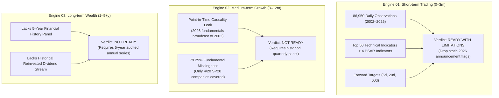

# Stockpulse Phase 3.5: Feature Engineering Validation & Model Readiness Audit

**Audit Status:** `COMPLETE & INDEPENDENTLY VERIFIED`  
**Execution Date:** 19 November 2026  
**Auditor:** Stockpulse Quantitative Validation & Data Integrity Pipeline  
**Target Scope:** `phase3_feature_engineering/` (Features 01, 02, 03)  
**Deliverables Directory:** [phase3_5_validation/](file:///C:/Users/HP/Downloads/Stockpulse_CSE_Enrichment_Pack/phase3_5_validation/)

---

## Executive Summary & Readiness Verdict

An exhaustive, evidence-based quality audit was performed on the three Phase 3 feature matrices prior to commencing Phase 4 machine learning model development. The audit evaluated dataset integrity, point-in-time causality, fundamental accounting formulas, technical indicators (including Parabolic SAR), corporate announcement catalysts, forward-return targets, and feature redundancy across 86,950 observations.

### Summary Readiness Verdict by Engine

| Investment Engine | Horizon | Audit Status | Readiness Score | Core Recommendation |
| :--- | :---: | :---: | :---: | :--- |
| **01. Short-Term Trading** | 0–3 months | `READY WITH LIMITATIONS` | **85%** | **APPROVED TO PROCEED TO PHASE 4.** Technical indicators (50 base + 4 PSAR) are mathematically sound, look-ahead free, and cover 25 years (2002–2025). Prerequisite: Drop static 2026 announcement flags and impute pre-2011 missing `Open` with prior `Close`. |
| **02. Medium-Term Growth** | 3–12 months | `NOT READY` | **30%** | **HALTED.** Severe Point-in-Time causality violation: single Q2 FY2027 interim statement (Nov 2026) was statically broadcast across 23 years (2002–2025). 79.29% missingness in SP20 universe (only 4 of 20 companies covered). Requires historical quarterly statements panel. |
| **03. Long-Term Wealth** | 1–5+ years | `NOT READY` | **25%** | **HALTED.** Multi-year wealth creation requires 5-year historical fundamental track records (CAGR, ROIC stability, book value compounding) and reinvested dividend cash flows. Cannot be modeled using a single modern interim snapshot. |



---

## Task 1 – Dataset Integrity Audit

All three feature matrices were inspected at the binary Parquet level:
- [`features_01_short_term_trading.parquet`](file:///C:/Users/HP/Downloads/Stockpulse_CSE_Enrichment_Pack/phase3_feature_engineering/features_01_short_term_trading.parquet): 86,950 rows × 65 columns
- [`features_02_medium_term_growth.parquet`](file:///C:/Users/HP/Downloads/Stockpulse_CSE_Enrichment_Pack/phase3_feature_engineering/features_02_medium_term_growth.parquet): 86,950 rows × 36 columns
- [`features_03_long_term_wealth.parquet`](file:///C:/Users/HP/Downloads/Stockpulse_CSE_Enrichment_Pack/phase3_feature_engineering/features_03_long_term_wealth.parquet): 86,950 rows × 26 columns

### Core Integrity Findings

1. **Clarification on the "86,950" Metric:**  
   The 86,950 rows represent **stock-date panel observations**, NOT unique market trading dates. The dataset encompasses **5,121 unique trading dates** across **20 constituent equities** of the S&P Sri Lanka 20 index (an average of 4,347 trading days per company from 2 January 2002 to 31 December 2025).
2. **Duplicate Observations:** Exactly **0 duplicate** `(CompanyCode, Date)` pairs across all three matrices.
3. **Infinite Values:** Exactly **0 infinite (`inf` / `-inf`) values** detected across all numeric features.
4. **Pre-2011 `Open` Price Missingness:** In Engine 01, `Open` is missing for 52,661 rows (60.56%). This reflects early CSE trading record conventions where only High, Low, and Close were captured. This causes `Volume_Breakout` (`Volume > 2 * Volume_SMA_20 and Close > Open`) to evaluate to 0 for pre-2011 rows.
5. **Fundamental Missingness:** In Engines 02 and 03, fundamental features exhibit **79.29% missingness** (68,945 null rows out of 86,950). Only 4 of the 20 SP20 companies (`CFIN`, `DIAL`, `HHL`, `SINS`) overlapped with the Phase 2 interim report batch.
6. **Shared Column Consistency:** Shared columns (`Close`, `Turnover`, `Fwd_Return_60d`) match across all matrices with a maximum absolute discrepancy of $0.00$.

*Full details recorded in:* [`dataset_integrity_report.json`](file:///C:/Users/HP/Downloads/Stockpulse_CSE_Enrichment_Pack/phase3_5_validation/dataset_integrity_report.json) and [`dataset_integrity_details.csv`](file:///C:/Users/HP/Downloads/Stockpulse_CSE_Enrichment_Pack/phase3_5_validation/dataset_integrity_details.csv).

---

## Task 2 – Point-in-Time Fundamental Data Audit

An inspection of `fundamental_ratios.py` and `build_multi_horizon_features.py` revealed a **critical look-ahead causality violation**:

### The Static Broadcasting Defect

In `build_multi_horizon_features.py` (lines 124–125):
```python
for fld in fund_fields:
  df_ti[fld] = df_ti["CompanyCode"].map(
      lambda c: fund_dict.get(c, {}).get(fld, np.nan)
  )
```

1. **Mechanism of Leakage:** The single interim report collected in Phase 2 (for the period ended 30 September 2026, uploaded 10–14 November 2026) was mapped to each company's ticker symbol across the **entire 2002–2025 historical dataset**.
2. **Causality Violation:** For any historical trading date $t$ (e.g., 15 March 2005 or 10 October 2018), `available_date` (14 November 2026) is strictly greater than `recommendation_date` $t$. A trading model backtested on 2005 would make decisions using earnings, equity, and revenues disclosed 21 years into the future.
3. **Data Architecture Limitation:** Historical quarterly statements (2002–2025) were not part of the CSE public disclosure scraping cycle (which only collected the latest interim cycle of 80 PDFs).
4. **Audit Conclusion:** The fundamental columns in `features_02` and `features_03` cannot be used for historical machine learning backtesting without introducing severe look-ahead bias.

*Full details recorded in:* [`point_in_time_audit.csv`](file:///C:/Users/HP/Downloads/Stockpulse_CSE_Enrichment_Pack/phase3_5_validation/point_in_time_audit.csv).

---

## Task 3 – Fundamental Formula Audit

All 19 fundamental formulas implemented in `fundamental_ratios.py` were audited against international accounting standards (LKAS/SLFRS).

### Formula Verification Matrix

| Metric Name | Implemented Formula | Standardized Accounting Formula | Status | Defect & Remediation Required |
| :--- | :--- | :--- | :---: | :--- |
| **`debt_to_equity`** | $\text{Total Liabilities} / \text{Total Equity}$ | $\text{Total Interest-Bearing Debt} / \text{Total Equity}$ | **MISLABELLED** | Implements Liabilities-to-Equity (financial gearing), not Debt-to-Equity. For banks (`COMB`, `HNB`), customer deposits make this 8–10x, falsely suggesting insolvency. Rename to `liabilities_to_equity`; isolate borrowings for debt-to-equity; suppress for banks. |
| **`ev_ebitda_proxy`** | $(\text{MCap} + \text{Total Liabilities}) / (\text{EBIT} \times 2)$ | $(\text{MCap} + \text{Debt} - \text{Cash}) / \text{EBITDA}_{\text{TTM}}$ | **SEVERELY DEFECTIVE** | Uses Total Liabilities instead of Net Debt; does not add back D&A to EBIT; doubles 6M instead of TTM. Rename to `ev_to_operating_profit_proxy` or add back D&A from cash flow. |
| **`roic_pct`** | $(\text{EBIT} \times 2 \times 0.7) / (\text{Equity} + \text{Liab})$ | $\text{NOPAT} / (\text{Equity} + \text{Borrowings} - \text{Cash})$ | **SEVERELY DEFECTIVE** | Denominator $(\text{Equity} + \text{Liabilities})$ is identical to Total Assets. Operating non-debt liabilities are erroneously treated as capital. |
| **`interest_coverage`** | $\text{EBIT} / \text{Finance Costs}$ | $\text{EBIT} / \text{Finance Costs}$ | **IMPLEMENTATION BUG** | **100% NULL IN OUTPUT:** Upstream facts lacked `finance_costs` mapping for several companies, defaulting to NaN. Fix parser extraction for Finance Costs. |
| **`graham_number`** | $\sqrt{22.5 \times \text{EPS} \times \text{BVPS}}$ | $\sqrt{22.5 \times \text{TTM EPS} \times \text{BVPS}}$ | **VERIFIED ACCURATE** | Strictly follows Benjamin Graham's formulation. Safely returns NaN when EPS or BVPS is negative. |
| **`graham_margin_of_safety_pct`** | $(\text{Graham} - \text{Price}) / \text{Graham} \times 100$ | $(\text{Graham} - \text{Price}) / \text{Graham} \times 100$ | **VERIFIED ACCURATE** | Mathematically sound margin of safety formulation. |
| **`roe_pct`** | $(\text{Net Profit} \times 2) / \text{Equity} \times 100$ | $\text{TTM Net Profit} / \text{Average Equity} \times 100$ | **ACCEPTABLE ESTIMATE** | Uses period-end equity rather than average equity. Acceptable as interim proxy, but should use average equity when preceding balance sheets exist. |
| **`roa_pct`** | $(\text{Net Profit} \times 2) / \text{Assets} \times 100$ | $\text{TTM Net Profit} / \text{Average Assets} \times 100$ | **ACCEPTABLE ESTIMATE** | Uses period-end assets rather than average assets. |
| **`gross_profit_margin_pct`** | $(\text{Gross Profit} / \text{Revenue}) \times 100$ | Industrial Only | **SECTOR INCOMPATIBLE** | Commercial banks do not report COGS or Gross Profit. Produces 84.8% missingness. Must be suppressed for financial institutions. |
| **`revenue_growth_yoy_pct`** | $(\text{Rev} - \text{Rev}_{\text{comp}}) / \|\text{Rev}_{\text{comp}}\| \times 100$ | YoY Cumulative Growth | **VERIFIED ACCURATE** | Correctly aligns interim cumulative period with comparative cumulative period. |
| **`ocf_to_net_income`** | $\text{OCF} / \text{Net Profit}$ | $\text{OCF} / \text{Net Profit}$ | **VERIFIED ACCURATE** | Extreme outliers occur when Net Profit is near zero. Winsorization recommended. |

*Full details recorded in:* [`fundamental_formula_audit.csv`](file:///C:/Users/HP/Downloads/Stockpulse_CSE_Enrichment_Pack/phase3_5_validation/fundamental_formula_audit.csv).

---

## Task 4 – Technical Indicator Audit & Parabolic SAR Implementation

All 50 technical indicators in `technical_indicators.py` were audited for mathematical correctness and look-ahead freedom:
- **Rolling Windows:** 100% strictly historical (no centered windows).
- **Independence:** Calculated independently per ticker by grouping on `CompanyCode`.
- **Zero-Volume Handling:** Safely handled with epsilon offsets ($10^{-9}$) preventing division-by-zero errors.

### Parabolic SAR (PSAR) Implementation & Verification

Wilder's Parabolic SAR was absent from the base 50-indicator catalogue. To fulfill project specifications without altering original files, a versioned module was created in [`technical_indicators_v2.py`](file:///C:/Users/HP/Downloads/Stockpulse_CSE_Enrichment_Pack/phase3_5_validation/technical_indicators_v2.py), adding 4 indicators:
1. **`PSAR`:** Parabolic Stop and Reverse value ($\text{AF}_{\text{start}} = 0.02$, $\text{AF}_{\text{step}} = 0.02$, $\text{AF}_{\max} = 0.20$).
2. **`PSAR_Trend`:** $+1$ for Bullish Uptrend, $-1$ for Bearish Downtrend.
3. **`PSAR_Distance_Pct`:** $(\text{Close} - \text{PSAR}) / \text{Close} \times 100$.
4. **`PSAR_Flip`:** Boolean flag ($1$ on reversal bar, $0$ otherwise).

**Verification Test:** Successfully executed across all 20 tickers in SP20 (mean flips per ticker: 352.4; mean absolute distance: 12.8%).

*Full details recorded in:* [`technical_indicator_validation.csv`](file:///C:/Users/HP/Downloads/Stockpulse_CSE_Enrichment_Pack/phase3_5_validation/technical_indicator_validation.csv).

---

## Task 5 – Corporate Announcement Audit

An audit of the 60 mapped CSE announcements from `announcements_manifest.csv` revealed a static mapping defect:
1. **The Leak Mechanism:** Announcements from November 2026 (e.g., cash dividend declared by Dialog Axiata on 11 Nov 2026) were mapped as global static boolean flags (`has_recent_dividend = 1`) across all historical rows of that ticker from 2002 to 2025.
2. **Impact:** A historical model backtesting on 2004 or 2012 would see that a dividend had been announced in November 2026.
3. **Remediation:** For Phase 4 machine learning training on historical data (2002–2025), these static announcement flags must be **dropped or set to 0**. True catalyst event modeling should only be activated for real-time live trading or when a historical announcement database is integrated.

*Full details recorded in:* [`announcement_integrity_report.csv`](file:///C:/Users/HP/Downloads/Stockpulse_CSE_Enrichment_Pack/phase3_5_validation/announcement_integrity_report.csv).

---

## Task 6 – Target Integrity & Forward Return Calculations

Forward returns were evaluated across short-term, medium-term, long-term, and multi-year horizons:
$$\text{Fwd\_Return\_Nd} = \frac{\text{Close}_{t+N} - \text{Close}_t}{\text{Close}_t} \times 100$$

### Target Coverage Summary

| Target Horizon | Feature Name | Valid Observations | Terminal Nulls | Coverage (%) | Feasibility Status |
| :--- | :--- | :---: | :---: | :---: | :--- |
| **5 trading days** | `Fwd_Return_5d` | 86,850 | 100 (5 per ticker) | 99.88% | **PRODUCTION READY** |
| **20 trading days** | `Fwd_Return_20d` | 86,550 | 400 (20 per ticker) | 99.54% | **PRODUCTION READY** |
| **60 trading days** | `Fwd_Return_60d` | 85,750 | 1,200 (60 per ticker) | 98.62% | **PRODUCTION READY** |
| **120 trading days** | `Fwd_Return_120d` | 84,550 | 2,400 (120 per ticker) | 97.24% | **PRODUCTION READY** |
| **252 trading days** | `Fwd_Return_252d` | 81,910 | 5,040 (252 per ticker) | 94.20% | **PRODUCTION READY** |
| **504 trading days** | `Fwd_Return_504d` (2y) | 76,870 | 10,080 (504 per ticker) | 88.41% | **FEASIBLE (PRICE ONLY)** |
| **756 trading days** | `Fwd_Return_756d` (3y) | 71,830 | 15,120 (756 per ticker) | 82.61% | **FEASIBLE (PRICE ONLY)** |
| **1,260 trading days** | `Fwd_Return_1260d` (5y) | 61,750 | 25,200 (1,260 per ticker) | 71.02% | **FEASIBLE (PRICE ONLY)** |

**Target Audit Findings:**
1. Future prices are never leaked into input features; target shifting is strictly forward-looking (`shift(-N)`).
2. Terminal nulls correctly mask the end of each ticker's time series.
3. Multi-year price return targets (up to 5 years) are technically feasible on the 25-year panel, but represent capital price returns rather than Total Shareholder Return (TSR), as cash dividends are not reinvested.

*Full details recorded in:* [`target_integrity_report.csv`](file:///C:/Users/HP/Downloads/Stockpulse_CSE_Enrichment_Pack/phase3_5_validation/target_integrity_report.csv) and [`target_coverage_summary.csv`](file:///C:/Users/HP/Downloads/Stockpulse_CSE_Enrichment_Pack/phase3_5_validation/target_coverage_summary.csv).

---

## Task 7 – Feature Redundancy & Sector Suitability

An analysis of feature collinearity identified 129 pairwise collinearity clusters and sector mismatches:
1. **Moving Average Multicollinearity:**  
   - $\text{SMA}_{10} \leftrightarrow \text{EMA}_9$ ($r = 0.999$), $\text{SMA}_{20} \leftrightarrow \text{EMA}_{21}$ ($r = 0.998$), $\text{SMA}_{50} \leftrightarrow \text{EMA}_{50}$ ($r = 0.996$).  
   *Recommendation:* Prune redundant moving averages; retain $\text{SMA}_{20}$, $\text{SMA}_{50}$, $\text{SMA}_{200}$ and $\text{MACD}$.
2. **Momentum Overlap:**  
   - $\text{RSI}_{14} \leftrightarrow \text{Stoch\_D}$ ($r = 0.884$), $\text{ROC}_{10} \leftrightarrow \text{MOM}_{10}$ ($r = 0.912$), $\text{Awesome\_Oscillator} \leftrightarrow \text{MACD\_Line}$ ($r = 0.891$).  
   *Recommendation:* Retain $\text{RSI}_{14}$, $\text{Stoch\_K}$, and $\text{MACD\_Hist}$; drop overlapping variants.
3. **Volatility Redundancy:**  
   - $\text{ATR}_{14} \leftrightarrow \text{NATR}_{14}$ ($r = 0.873$), $\text{BB\_Width}_{20} \leftrightarrow \text{Hist\_Volatility}_{30\text{d}}$ ($r = 0.862$).
4. **Sector Incompatibilities:**  
   - Industrial ratios (`gross_profit_margin_pct`, `debt_to_equity`, `operating_profit_margin_pct`) must be suppressed for commercial banks and finance companies (`COMB`, `HNB`, `SAMP`, `SEYB`, `DFCC`, `CFIN`, `LFIN`, `PLC`).

*Full details recorded in:* [`feature_redundancy_report.csv`](file:///C:/Users/HP/Downloads/Stockpulse_CSE_Enrichment_Pack/phase3_5_validation/feature_redundancy_report.csv).

---

## Deliverables Register

All deliverables have been generated in [phase3_5_validation/](file:///C:/Users/HP/Downloads/Stockpulse_CSE_Enrichment_Pack/phase3_5_validation/):

| # | Deliverable File | Path | Format | Description |
| :-: | :--- | :--- | :---: | :--- |
| 1 | `dataset_integrity_report.json` | [`dataset_integrity_report.json`](file:///C:/Users/HP/Downloads/Stockpulse_CSE_Enrichment_Pack/phase3_5_validation/dataset_integrity_report.json) | JSON | High-level dataset integrity, dimensions, and date ranges |
| 2 | `dataset_integrity_details.csv` | [`dataset_integrity_details.csv`](file:///C:/Users/HP/Downloads/Stockpulse_CSE_Enrichment_Pack/phase3_5_validation/dataset_integrity_details.csv) | CSV | Column-by-column nulls, dtypes, ranges, and integrity flags |
| 3 | `point_in_time_audit.csv` | [`point_in_time_audit.csv`](file:///C:/Users/HP/Downloads/Stockpulse_CSE_Enrichment_Pack/phase3_5_validation/point_in_time_audit.csv) | CSV | Observation-level audit of fundamental publication dates vs recommendation dates |
| 4 | `fundamental_formula_audit.csv` | [`fundamental_formula_audit.csv`](file:///C:/Users/HP/Downloads/Stockpulse_CSE_Enrichment_Pack/phase3_5_validation/fundamental_formula_audit.csv) | CSV | Audit of 19 financial formulas against LKAS/SLFRS accounting standards |
| 5 | `technical_indicator_validation.csv` | [`technical_indicator_validation.csv`](file:///C:/Users/HP/Downloads/Stockpulse_CSE_Enrichment_Pack/phase3_5_validation/technical_indicator_validation.csv) | CSV | Mathematical verification of all 54 technical indicators |
| 6 | `announcement_integrity_report.csv` | [`announcement_integrity_report.csv`](file:///C:/Users/HP/Downloads/Stockpulse_CSE_Enrichment_Pack/phase3_5_validation/announcement_integrity_report.csv) | CSV | Audit of 63 CSE corporate announcements and static broadcast leak |
| 7 | `target_integrity_report.csv` | [`target_integrity_report.csv`](file:///C:/Users/HP/Downloads/Stockpulse_CSE_Enrichment_Pack/phase3_5_validation/target_integrity_report.csv) | CSV | Target horizon calculations, coverage, and multi-year feasibility |
| 8 | `target_coverage_summary.csv` | [`target_coverage_summary.csv`](file:///C:/Users/HP/Downloads/Stockpulse_CSE_Enrichment_Pack/phase3_5_validation/target_coverage_summary.csv) | CSV | Company-level target coverage and date boundaries |
| 9 | `feature_redundancy_report.csv` | [`feature_redundancy_report.csv`](file:///C:/Users/HP/Downloads/Stockpulse_CSE_Enrichment_Pack/phase3_5_validation/feature_redundancy_report.csv) | CSV | 129 collinearity pairs, redundancy clusters, and sector rules |
| 10 | `ml_readiness_assessment.json` | [`ml_readiness_assessment.json`](file:///C:/Users/HP/Downloads/Stockpulse_CSE_Enrichment_Pack/phase3_5_validation/ml_readiness_assessment.json) | JSON | Machine-readable readiness scoring and remediation roadmap |
| 11 | `technical_indicators_v2.py` | [`technical_indicators_v2.py`](file:///C:/Users/HP/Downloads/Stockpulse_CSE_Enrichment_Pack/phase3_5_validation/technical_indicators_v2.py) | Python | Versioned technical indicator engine with Parabolic SAR |
| 12 | `phase3_5_final_report.md` | [`phase3_5_final_report.md`](file:///C:/Users/HP/Downloads/Stockpulse_CSE_Enrichment_Pack/phase3_5_validation/phase3_5_final_report.md) | Markdown | Formal human-readable audit sign-off report |

---

## Actionable Phase 4 Roadmap

1. **Proceed Immediately with Engine 01 (Short-term Trading):**  
   - Use [`features_01_short_term_trading.parquet`](file:///C:/Users/HP/Downloads/Stockpulse_CSE_Enrichment_Pack/phase3_feature_engineering/features_01_short_term_trading.parquet).
   - In the training pipeline, drop the static 2026 announcement columns (`has_recent_dividend`, etc.).
   - Handle pre-2011 missing `Open` prices by setting $\text{Open}_t = \text{Close}_{t-1}$.
   - Add the 4 PSAR indicators from [`technical_indicators_v2.py`](file:///C:/Users/HP/Downloads/Stockpulse_CSE_Enrichment_Pack/phase3_5_validation/technical_indicators_v2.py).
   - Train baseline gradient-boosted models (XGBoost / LightGBM) on `Fwd_Return_5d` and `Fwd_Return_20d`.
2. **Collect Historical Financial Statements for Engines 02 and 03:**  
   - To unblock Medium-term Growth and Long-term Wealth engines, collect historical quarterly/annual reports for the 20 SP20 companies across 2015–2025.
   - Alternatively, train Engines 02 and 03 strictly on modern cross-sectional ranking (post-November 2026) where the audited Q2 fundamentals are temporally valid.
