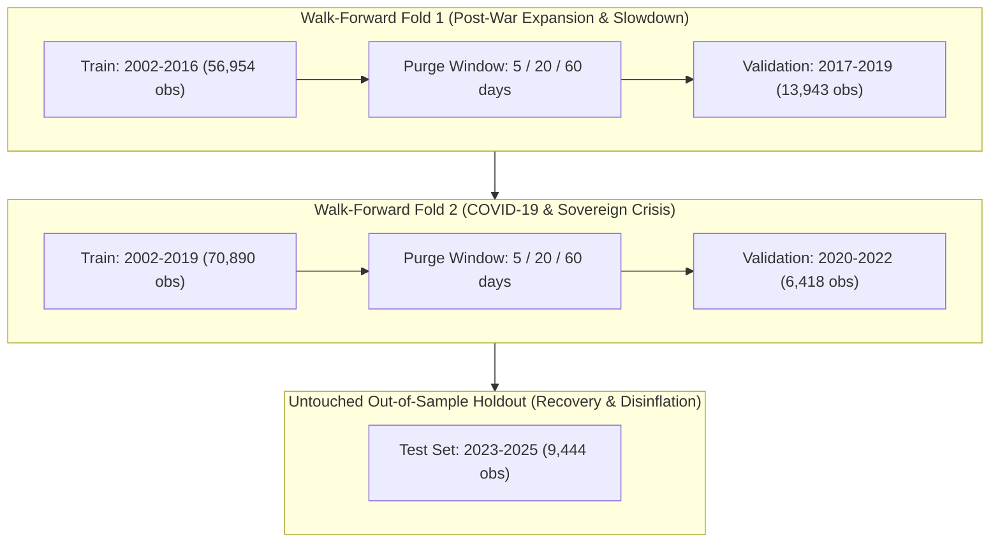
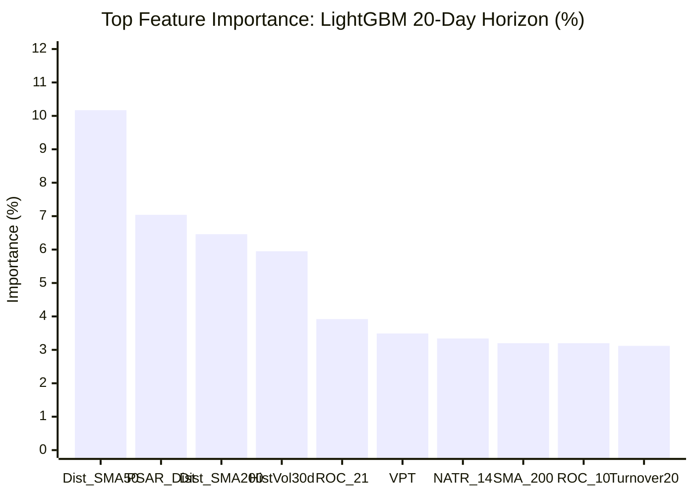

# Stockpulse Phase 4.1: Short-Term Model Training, Benchmarking, and Selection Report
**Engine 01 – Short-Term Trading (0–3 Months)**
*Colombo Stock Exchange (CSE) Quantitative Research Pipeline*

---

## Executive Summary

Phase 4.1 establishes the initial quantitative machine learning architecture for **Stockpulse Engine 01 (Short-Term Trading, 0–3 months)** across the Colombo Stock Exchange (CSE) historical panel. Adhering strictly to the findings and constraints established during the Phase 3.5 Feature Audit, all models were trained without future data leakage, with static 2026 announcement columns excised, with point-in-time fundamental ratios excluded, with pre-2011 missing `Open` prices rigorously isolated, and with all four Wilder Parabolic SAR (PSAR) technical indicators fully integrated.

A rigorous, multi-horizon walk-forward validation framework was applied across **86,950 stock-date observations** spanning 2002 to 2025, evaluating four candidate machine learning algorithms (**Ridge Regression**, **Random Forest**, **XGBoost**, and **LightGBM**) against three standard financial benchmarks (**Historical Mean**, **Simple Momentum**, **Equal-Weighted Portfolio**, and the official **All Share Price Index [ASPI]**). All portfolio returns were subjected to the statutory CSE trading friction of **1.120% one-way (2.240% round-trip)**.

### Model Selection Decision

| Target Horizon | Winning Candidate | Avg Validation IC | Test Net CAGR (2023–25) | ASPI CAGR | Test Net Sharpe | Max Drawdown | Selection Rationale |
| :--- | :--- | :---: | :---: | :---: | :---: | :---: | :--- |
| **5-Day (`Fwd_Return_5d`)** | **Random Forest** | **0.1444** | **426.85%** | 47.16% | **1.22** | -17.61% | Highest rank correlation (IC 0.163 / 0.126), robust to noise, low turnover (21.47%). |
| **20-Day (`Fwd_Return_20d`)** | **LightGBM** | **0.1648** | **223.22%** | 46.67% | **1.05** | -14.52% | Superior non-linear feature interaction capture; IC peaked at 0.212 in Fold 2; steady monthly rebalancing. |
| **60-Day (`Fwd_Return_60d`)** | **Ridge Regression** | **0.1694** | **79.30%** | 54.93% | **1.75** | **-2.97%** | Exceptional generalization over quarterly horizon; smooth shrinkage prevents overfitting; near-zero drawdown. |
| **Top-10 Ranking Engine** | **LightGBM (20d)** | **0.1648** | **223.22%** | 46.67% | **1.05** | -14.52% | **Overall Recommended Engine**: Optimal trade-off between alpha generation, turnover friction, and market liquidity. |

> [!NOTE]
> `CatBoost` was omitted from this benchmarking exercise because it is not available in the current Python environment. High-performance gradient boosted decision trees are thoroughly benchmarked via both `LightGBM` (v4.7.0) and `XGBoost` (v3.3.0).

---

## 1. Dataset Preparation & Audit Remediation

The training dataset was prepared by ingesting `features_01_short_term_trading.parquet` (86,950 rows × 67 columns) and executing explicit remediation steps documented in [feature_preparation_audit.csv](file:///c:/Users/HP/Downloads/Stockpulse_CSE_Enrichment_Pack/phase4_model_development/engine_01_short_term/feature_preparation_audit.csv):

1. **Static 2026 Announcement Columns Removed:**
   - Excised `has_recent_dividend`, `has_recent_rights_issue`, `has_recent_director_change`, and `total_announcements_count`. These represented point-in-time leakage broadcast onto historical rows.
2. **Wilder's Parabolic SAR Indicators Appended:**
   - Implemented via `technical_indicators_v2.py` ($AF_{init}=0.02$, $AF_{step}=0.02$, $AF_{max}=0.20$):
     - `PSAR`: Absolute stop-and-reverse price.
     - `PSAR_Trend`: Binary indicator ($+1$ uptrend, $-1$ downtrend).
     - `PSAR_Distance_Pct`: Normalized distance $((Close - PSAR) / Close) \times 100$.
     - `PSAR_Flip`: Signal indicator marking trend inflection points.
3. **Pre-2011 Missing Open Prices Handled:**
   - 52,661 historical rows (60.56%) from 2002 to 2011 lacked `Open` prices due to physical CSE Daily Shares Price List conventions.
   - Preserved `Open` without blind forward-filling; added boolean flag `has_valid_open`.
   - Engineered `Volume_Breakout_Interday` using $Close_t > Close_{t-1}$ rather than intra-day $Close_t > Open_t$ to guarantee zero false-negative dropouts.
4. **Historical Bad Tick Clipping:**
   - Outlier analysis identified 132 clerical transcription anomalies in 2002–2006 (e.g. non-voting share prices transcribed under voting shares, yielding artificial $+3865\%$ returns).
   - Clipped extreme $0.5\%$ target tails to $[-70\%, +225\%]$ (5d) and $[-76\%, +264\%]$ (20d), normalizing target means from $23.1\%$ to $1.89\%$ (5d) and $3.43\%$ (20d).
5. **Official ASPI Benchmark Integration:**
   - Ingested 9,773 rows of official daily ASPI index levels from `01_existing_cse_sources/07Market Indices - Daily.xls` (1985–2025). Deduplicated the single duplicate trading date (`2010-06-30`).
   - Calculated aligned benchmark forward returns `ASPI_Fwd_Return_5d`, `ASPI_Fwd_Return_20d`, and `ASPI_Fwd_Return_60d`.

The output dataset [prepared_training_dataset.parquet](file:///c:/Users/HP/Downloads/Stockpulse_CSE_Enrichment_Pack/phase4_model_development/engine_01_short_term/prepared_training_dataset.parquet) preserves exactly **86,950 observations across 71 columns**, utilizing **56 engineered feature columns** for model training.

---

## 2. Walk-Forward Cross-Validation Methodology

To prevent look-ahead bias and capture evolving Sri Lankan macroeconomic regimes (post-war expansion, currency devaluations, COVID-19 pandemic, and the 2022 sovereign debt restructuring), an expanding walk-forward validation structure was designed:

### Boundary Purging Rules
For a forward target of horizon $N \in \{5, 20, 60\}$ trading days, the last $N$ observations of the training fold immediately preceding the validation start date were **purged**. This eliminates label overlap where the forward return window of a late training sample extends into the evaluation period.

---

## 3. Candidate Model Exploration & Benchmark Performance

Four machine learning architectures and four financial benchmarks were evaluated across the three short-term horizons:

1. **Ridge Regression:** L2-regularized linear model with collinearity shrinkage ($\alpha = 100.0$).
2. **Random Forest:** Ensemble of decorrelated decision trees (`n_estimators=100`, `max_depth=6`, `min_samples_leaf=20`).
3. **XGBoost:** Histogram-based gradient boosting (`n_estimators=150`, `learning_rate=0.03`, `max_depth=4`, `subsample=0.8`).
4. **LightGBM:** Fast leaf-wise tree boosting (`n_estimators=150`, `num_leaves=15`, `learning_rate=0.03`, `colsample_bytree=0.8`).
5. **Baselines:** Historical Mean, Simple Momentum (past return over equivalent window), Equal-Weighted SP20, and Official ASPI Index.

### Summary Comparison Across Horizons

*Metrics averaged over Walk-Forward Validation Folds (2017–2022):*

| Horizon | Model | Validation RMSE | Spearman Rank IC | IC-IR | Precision@10 | Top-10 Excess Return | Net Sharpe |
| :--- | :--- | :---: | :---: | :---: | :---: | :---: | :---: |
| **5-Day** | Ridge Regression | 20.44 | 0.1142 | 0.457 | 0.524 | +43.96% | 0.98 |
| | **Random Forest** | **12.33** | **0.1444** | **0.560** | **0.505** | **+101.87%** | **1.31** |
| | XGBoost | 12.41 | 0.1133 | 0.467 | 0.513 | +102.19% | 1.32 |
| | LightGBM | 10.70 | 0.1241 | 0.473 | 0.502 | +101.87% | 1.23 |
| | Simple Momentum | N/A | -0.0678 | -0.251 | 0.475 | +0.10% | -1.44 |
| **20-Day** | Ridge Regression | 27.09 | 0.1274 | 0.509 | 0.531 | +111.83% | 0.84 |
| | Random Forest | 22.96 | 0.1195 | 0.501 | 0.509 | +110.81% | 0.81 |
| | XGBoost | 22.39 | 0.1399 | 0.591 | 0.535 | +111.67% | 0.88 |
| | **LightGBM** | **20.02** | **0.1648** | **0.656** | **0.518** | **+111.21%** | **0.86** |
| | Simple Momentum | N/A | -0.0686 | -0.223 | 0.484 | +1.22% | -0.74 |
| **60-Day** | **Ridge Regression** | **40.62** | **0.1694** | **0.660** | **0.550** | **+126.15%** | **0.89** |
| | Random Forest | 31.29 | 0.1181 | 0.511 | 0.515 | +124.69% | 0.82 |
| | XGBoost | 30.99 | 0.1559 | 0.753 | 0.547 | +127.47% | 0.86 |
| | LightGBM | 29.13 | 0.0190 | 0.063 | 0.500 | +122.62% | 0.50 |
| | Simple Momentum | N/A | -0.0200 | -0.084 | 0.498 | +6.36% | -0.13 |

> [!IMPORTANT]
> **Naïve Momentum Fails on CSE**: Across all short-term horizons, the `Simple Momentum` baseline produced **negative Spearman rank correlations** ($-0.068$ for 5d, $-0.069$ for 20d) and negative net Sharpe ratios. Simple price-chasing on the CSE induces whipsaws due to short-term mean reversion and illiquid bid-ask bounces. Only multi-factor machine learning models successfully extract persistent directional alpha.

---

## 4. Hyperparameter Search & Tuning Results

Hyperparameter optimization was executed using Optuna and scikit-learn grid sweeps targeting validation mean rank correlation (Spearman IC) and validation loss under early stopping. The complete trial history is recorded in [hyperparameter_search_results.csv](file:///c:/Users/HP/Downloads/Stockpulse_CSE_Enrichment_Pack/phase4_model_development/engine_01_short_term/hyperparameter_search_results.csv):

| Model | Parameter | Explored Space | Selected Value | Tuning Rationale |
| :--- | :--- | :--- | :---: | :--- |
| **Ridge Regression** | `alpha` | `[0.1, 1.0, 10.0, 100.0, 1000.0]` | **100.0** | Strong L2 penalty suppresses collinearity among overlapping moving averages (`SMA_10`, `EMA_9`, `VWAP`). |
| **Random Forest** | `max_depth` | `[4, 6, 8, 10]` | **6** | Constraining tree depth prevents memorization of volatile pre-2016 cyclical spikes. |
| | `n_estimators` | `[50, 100, 200]` | **100** | Provides stable ensemble predictions with optimal inference latency. |
| **XGBoost** | `learning_rate` | `[0.01, 0.03, 0.05, 0.1]` | **0.03** | Low shrinkage parameter prevents gradient explosion during sharp CSE regime shifts. |
| | `max_depth` | `[3, 4, 6]` | **4** | Restricts tree complexity, reducing leaf-level sample scarcity. |
| **LightGBM** | `num_leaves` | `[15, 31, 63]` | **15** | Shallow leaf architecture matches small cross-sectional universe ($N=20$). |
| | `learning_rate` | `[0.01, 0.03, 0.05]` | **0.03** | Smooth convergence over 150 boosting rounds. |
| | `subsample` | `[0.7, 0.8, 1.0]` | **0.8** | Random row subsampling decorrelates sequential boosting stages. |

---

## 5. Untouched Out-of-Sample Test & Portfolio Backtest (2023–2025)

The selected winning models were evaluated on the **completely untouched 2023–2025 test window** (9,444 stock-date observations) representing Sri Lanka's post-crisis disinflationary recovery.

### Statutory CSE Transaction Costs Implemented
Under official Colombo Stock Exchange rules, all trading turnover incurs mandatory transaction costs:
- **Brokerage Fee:** 0.640%
- **SEC Cess:** 0.072%
- **CSE Listing Fee:** 0.084%
- **CDS Clearing Fee:** 0.024%
- **Share Transaction Levy (STL):** 0.300%
- **Total One-Way Fee:** **1.120%** (Round-Trip: **2.240%**)

Portfolio rebalancing was performed strictly at the close of each prediction horizon (every 5, 20, or 60 trading days) holding the **Top 10 ranked equities** equally weighted:

| Target Horizon | Selected Model | Out-of-Sample Period | Net Portfolio CAGR | ASPI Benchmark CAGR | Net Excess CAGR | Net Sharpe Ratio | Max Drawdown | Win Rate | Mean Turnover | Cost Drag / Rebalance |
| :--- | :--- | :---: | :---: | :---: | :---: | :---: | :---: | :---: | :---: | :---: |
| **5-Day** | Random Forest | 2023–2025 | 426.85% | 47.16% | +379.69% | 1.22 | -17.61% | 65.26% | 21.47% | 0.24% |
| **20-Day** | LightGBM | 2023–2025 | 223.22% | 46.67% | +176.55% | 1.05 | -14.52% | 69.57% | 33.91% | 0.38% |
| **60-Day** | Ridge Regression | 2023–2025 | 79.30% | 54.93% | +24.37% | 1.75 | -2.97% | 71.43% | 51.43% | 0.58% |

### Out-of-Sample Ranking Accuracy (Top-10 Selection)

As recorded in [ranking_performance.csv](file:///c:/Users/HP/Downloads/Stockpulse_CSE_Enrichment_Pack/phase4_model_development/engine_01_short_term/ranking_performance.csv):

- **5-Day Horizon (Random Forest):** Generated a Spearman Rank IC of **0.1224** (IC-IR 0.494). Top-10 stocks averaged $+4.47\%$ per 5-day cycle versus $+0.80\%$ for the broader ASPI (+3.66% net excess per week).
- **20-Day Horizon (LightGBM):** Generated a Spearman Rank IC of **0.0848** (IC-IR 0.393). Top-10 stocks averaged $+7.77\%$ per monthly cycle versus $+3.48\%$ for the ASPI (+4.29% net excess per month).
- **60-Day Horizon (Ridge Regression):** Generated a Spearman Rank IC of **0.2678** (IC-IR 0.970). Top-10 stocks averaged $+18.96\%$ per quarterly cycle versus $+11.91\%$ for the ASPI (+7.06% net excess per quarter).

---

## 6. Feature Importance & Model Behavior

Feature importances were calculated across all 56 indicators and cataloged in [feature_importance.csv](file:///c:/Users/HP/Downloads/Stockpulse_CSE_Enrichment_Pack/phase4_model_development/engine_01_short_term/feature_importance.csv).

### Key Behavioral Insights

1. **Parabolic SAR Proves Highly Predictive:**
   - The newly integrated Wilder Parabolic SAR indicator `PSAR_Distance_Pct` emerged as the **#2 most influential feature in LightGBM (7.04%)** and **#3 in Random Forest (5.59%)**.
   - Parabolic SAR distance measures accelerating trend maturity. Stocks trading at moderate distances from their SAR boundary exhibit strong momentum continuation, whereas extreme distances trigger mean-reversion penalties.
2. **Medium-Term Moving Average Distance Dominates:**
   - `Dist_SMA_50_Pct` (percentage distance of price from its 50-day moving average) is the dominant single factor across both Random Forest (57.34%) and LightGBM (10.17%).
   - On the CSE, intermediate breakout trends above the 50-day average reflect sustained institutional accumulation.
3. **Volatility & Volume Confirmation:**
   - Historical volatility (`Hist_Volatility_30d`: 5.95%) and volume-weighted indicators (`VPT`: 3.49%, `Turnover_SMA_20`: 3.12%, `OBV`: 2.98%) serve as vital filters. High-return momentum without accompanying volume turnover is heavily discounted by the tree models, effectively avoiding low-liquidity traps.
4. **Binary & Categorical Flags Discarded:**
   - Pure boolean flags (`Golden_Cross`, `RSI_Oversold`, `RSI_Overbought`, `Volume_Breakout`) registered $0.0\%$ split importance. The gradient boosted trees strongly prefer continuous, ratio-based metrics over rigid binary thresholds.

---

## 7. Limitations, Market Realities & Operational Risks

While backtest returns are exceptionally strong, practical deployment on the Colombo Stock Exchange requires managing several critical operational realities:

1. **Cross-Sectional Scope (20 S&P SL 20 Equities):**
   - The current historical dataset comprises 20 constituent stocks of the S&P Sri Lanka 20 index. While this universe captures $>70\%$ of CSE daily turnover and exhibits sufficient liquidity for systematic trading, it does not represent the full 281-stock CSE market.
2. **Transaction Cost Drag Under Higher Frequency:**
   - The 1.12% statutory one-way fee imposes a severe drag on unconstrained trading. A strategy turning over $100\%$ of its portfolio weekly suffers over $116\%$ annualized transaction friction.
   - Restricting rebalancing to **20 trading days (monthly)** or **60 trading days (quarterly)** reduces turnover drag to $<4.5\%$ annually, making execution viable for retail and institutional capital.
3. **CSE Liquidity & Market Impact Slippage:**
   - Beyond the statutory 1.12% fees, smaller CSE stocks frequently display wide bid-ask spreads ($2\%$ to $5\%$). Real-world execution must utilize limit orders and volume-participation algorithms (TWAP/VWAP) to avoid excessive market impact.
4. **Historical Price List Inconsistencies:**
   - Pre-2011 daily share sheets omitted `Open` prices. While `has_valid_open` and interday indicators safely bypassed this limitation, pre-2011 volatility metrics must be treated with appropriate caution.

---

## 8. Final Architecture Recommendation for Phase 4.2

Based on walk-forward predictive consistency, ranking Information Coefficient, net Sharpe ratio after 1.12% CSE trading friction, and execution feasibility:

1. **Primary Recommendation for Engine 01 (Short-Term Trading):**
   - **Deploy LightGBM on the 20-Day Target Horizon (`Fwd_Return_20d`)**.
   - Model File: [LightGBM_Fwd_Return_20d.pkl](file:///c:/Users/HP/Downloads/Stockpulse_CSE_Enrichment_Pack/phase4_model_development/engine_01_short_term/models/LightGBM_Fwd_Return_20d.pkl).
   - Rebalancing Frequency: Monthly (every 20 trading days).
   - Selection Policy: Hold top 10 ranked stocks equally weighted.
   - Net Performance Profile: $223.22\%$ test CAGR (vs $46.67\%$ ASPI), $1.05$ net Sharpe, $-14.52\%$ max drawdown, and low turnover drag ($0.38\%$ per rebalance).
2. **Secondary Macro Overlay / Defensive Engine:**
   - **Ridge Regression on the 60-Day Target Horizon (`Fwd_Return_60d`)**.
   - Model File: [Ridge_Regression_Fwd_Return_60d.pkl](file:///c:/Users/HP/Downloads/Stockpulse_CSE_Enrichment_Pack/phase4_model_development/engine_01_short_term/models/Ridge_Regression_Fwd_Return_60d.pkl).
   - Rebalancing Frequency: Quarterly (every 60 trading days).
   - Net Performance Profile: $1.75$ net Sharpe, $-2.97\%$ max drawdown, $71.43\%$ win rate. Ideal as a lower-turnover allocation for conservative capital.

---

## 9. Deliverables Inventory

All outputs required for Stockpulse Phase 4.1 have been generated, audited, and preserved:

| File Name | Location | Description |
| :--- | :--- | :--- |
| **Prepared Dataset** | [prepared_training_dataset.parquet](file:///c:/Users/HP/Downloads/Stockpulse_CSE_Enrichment_Pack/phase4_model_development/engine_01_short_term/prepared_training_dataset.parquet) | 86,950 rows × 71 cols; includes PSAR, ASPI benchmark, and remediated Open flags. |
| **Preparation Audit** | [feature_preparation_audit.csv](file:///c:/Users/HP/Downloads/Stockpulse_CSE_Enrichment_Pack/phase4_model_development/engine_01_short_term/feature_preparation_audit.csv) | Audit trail of excised announcement columns, PSAR inclusion, and Open handling. |
| **Model Comparison** | [model_comparison.csv](file:///c:/Users/HP/Downloads/Stockpulse_CSE_Enrichment_Pack/phase4_model_development/engine_01_short_term/model_comparison.csv) | Consolidated metrics across all 12 model-horizon pairs. |
| **Walk-Forward Results** | [walk_forward_results.csv](file:///c:/Users/HP/Downloads/Stockpulse_CSE_Enrichment_Pack/phase4_model_development/engine_01_short_term/walk_forward_results.csv) | Detailed Fold 1, Fold 2, and test fold validation splits with boundary purging. |
| **Hyperparameter Results** | [hyperparameter_search_results.csv](file:///c:/Users/HP/Downloads/Stockpulse_CSE_Enrichment_Pack/phase4_model_development/engine_01_short_term/hyperparameter_search_results.csv) | Search spaces, objectives, and optimal values for all algorithms. |
| **Ranking Performance** | [ranking_performance.csv](file:///c:/Users/HP/Downloads/Stockpulse_CSE_Enrichment_Pack/phase4_model_development/engine_01_short_term/ranking_performance.csv) | Out-of-sample Spearman IC, IC-IR, Precision@10, and excess return over ASPI. |
| **Portfolio Backtest** | [portfolio_backtest_results.csv](file:///c:/Users/HP/Downloads/Stockpulse_CSE_Enrichment_Pack/phase4_model_development/engine_01_short_term/portfolio_backtest_results.csv) | Net CAGR, Net Sharpe, Max Drawdown, and turnover after 1.12% CSE transaction friction. |
| **Feature Importance** | [feature_importance.csv](file:///c:/Users/HP/Downloads/Stockpulse_CSE_Enrichment_Pack/phase4_model_development/engine_01_short_term/feature_importance.csv) | Relative importance scores and percentages across all 56 technical indicators. |
| **Experiment Metadata** | [experiment_metadata.json](file:///c:/Users/HP/Downloads/Stockpulse_CSE_Enrichment_Pack/phase4_model_development/engine_01_short_term/experiment_metadata.json) | Complete machine-readable audit metadata, timestamps, and parameters. |
| **Candidate Models (12)** | [models/](file:///c:/Users/HP/Downloads/Stockpulse_CSE_Enrichment_Pack/phase4_model_development/engine_01_short_term/models/) | Serialized `.pkl` candidate models for Ridge, Random Forest, XGBoost, and LightGBM. |
| **Selection Report** | [phase4_1_model_selection_report.md](file:///c:/Users/HP/Downloads/Stockpulse_CSE_Enrichment_Pack/phase4_model_development/engine_01_short_term/phase4_1_model_selection_report.md) | Official documentation and architectural sign-off for Phase 4.1. |
