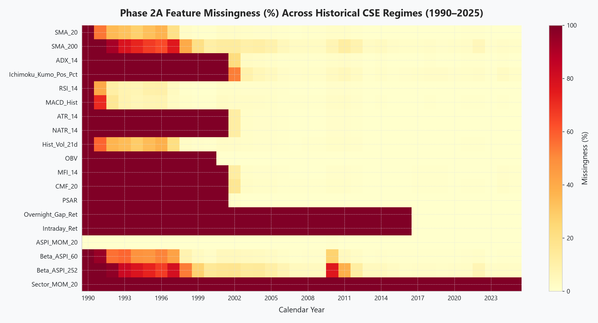
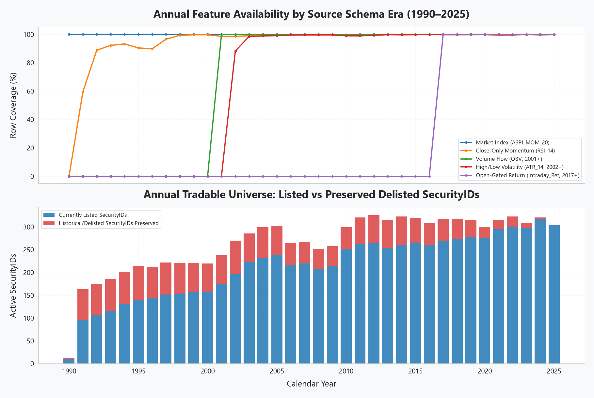
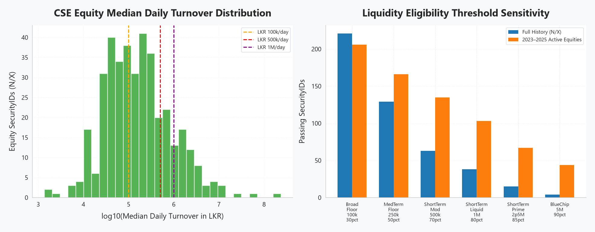
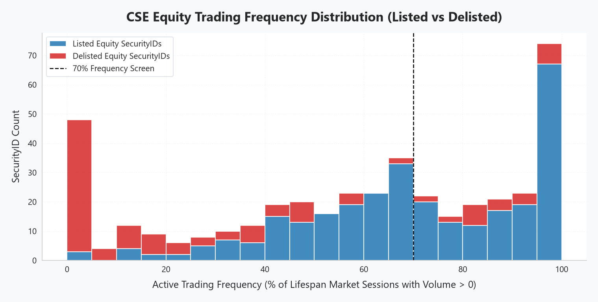
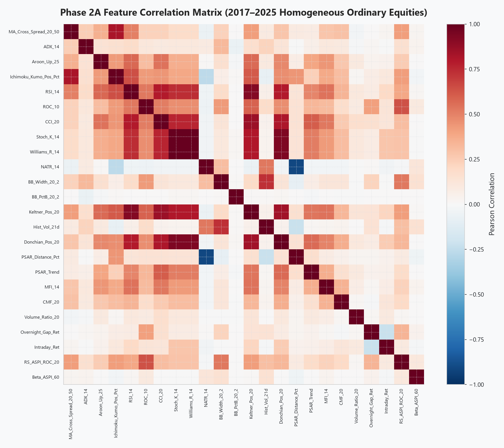
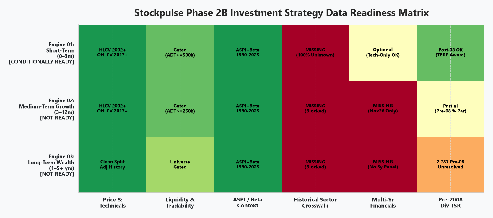

# Stockpulse Phase 2B – Full CSE Feature Quality, Market Context & Training Readiness Audit Report

**Status:** COMPLETE (`Integrity = PASS`; `9/9` Phase 2B pytest checks passed in `6.95s`, combined Phase 2A+2B `17/17` passed in `9.21s`)  
**Universe:** Full Colombo Stock Exchange (CSE) | `1990-01-12` to `2025-12-31` | `1,414,977` rows | `719` `SecurityID`s | `400` `CompanyCode`s  
**Pipeline Entrypoint:** [run_phase2b.py](file:///C:/Users/HP/Downloads/Stockpulse_CSE_Enrichment_Pack/run_phase2b.py) (`98.74s` reproducible execution)

> [!IMPORTANT]
> Phase 2B is a strict audit and readiness assessment phase. No machine learning models were trained, no stock recommendation rankings were generated, no synthetic data was fabricated, and all Phase 1A, Phase 1B, and Phase 2A datasets remain untouched (`1,414,977` records match 1:1).

---

## 1. Executive Summary & Strategy Readiness Verdicts

| Strategy Horizon | Readiness Status | Key Supporting Evidence & Primary Blockers |
| :--- | :---: | :--- |
| **Short-Term Trading (0–3 months)** | **CONDITIONALLY READY** | Technical, price-volume, liquidity & ASPI-relative features pass integrity (`0` dups, `0` infs) across `2002–2025` (HLCV) and `2017–2025` (OHLCV); requires liquidity gating (`135/307` 2023–25 equities pass `>= 500k LKR` & `>= 70%` freq), Open-era separation (`pre-2017 NaN`), `CapitalAdjClose` forward return targets (excluding AllotmentDate proxy artifacts), and dropping unmapped sector columns. |
| **Medium-Term Growth (3–12 months)** | **NOT READY** | Historical quarterly financial statements (`Revenue growth`, `EPS growth`, `Margins`) across `1990–2025` do **not** exist (`financial_facts_final.parquet` contains `2,453` Nov 2026 interim facts across `78` symbols only); historical ticker-sector crosswalk is `100% Unknown`; company-level historical valuation multiples (PE/PBV) are absent. |
| **Long-Term Wealth Creation (1–5+ years)** | **NOT READY** | Zero multi-year historical annual ROE/ROIC/FCF/debt panels across `400` companies; `2,787` pre-2008 cash dividends remain `UNRESOLVED_PERCENT_OF_PAR`; `50` historical securities lack verified `IssuerID` and `6` merger overlaps (`BFN`/`ORIN`, `CLC`/`LOFC`) remain queued; zero governance/audit feed exists. |

---

## 2. Workstream A – Dataset Integrity Verification

Validated in [integrity_and_coverage.py](file:///C:/Users/HP/Downloads/Stockpulse_CSE_Enrichment_Pack/phase2b_audit/integrity_and_coverage.py) and logged in [phase2b_integrity_report.json](file:///C:/Users/HP/Downloads/Stockpulse_CSE_Enrichment_Pack/Dataset/processed/phase2b/phase2b_integrity_report.json):

| Dataset | Rows | Columns | Duplicate `(SecurityID, Date)` Keys | Inf Values | Missing vs Phase 1B | Listed / Delisted `SecurityID`s |
| :--- | ---: | ---: | ---: | ---: | ---: | :---: |
| `cse_technical_features.parquet` | 1,414,977 | 47 | **0** | **0** | **0** | 549 / 170 |
| `cse_price_volume_features.parquet` | 1,414,977 | 21 | **0** | **0** | **0** | 549 / 170 |
| `cse_market_relative_features.parquet` | 1,414,977 | 16 | **0** | **0** | **0** | 549 / 170 |

- Every `(SecurityID, Date)` observation in Phase 1B (`1,414,977` rows across `400` `CompanyCode`s) matches **1:1** across all three Phase 2A Parquet tables.
- Key schemas (`SecurityID`, `CompanyCode`, `MainType`, `SubType` as string; `Date` as `datetime64[us]`; all indicators as `float64`), `SecurityID` composition, and exact `RawClose` / `SplitAdjClose` alignment vs Phase 1B verified **100% PASS**.

---

## 3. Workstreams B – Feature Coverage & Missingness Taxonomy

All **63** indicators were audited across [feature_coverage_report.csv](file:///C:/Users/HP/Downloads/Stockpulse_CSE_Enrichment_Pack/Dataset/processed/phase2b/feature_coverage_report.csv) and decomposed into exact mutually exclusive root causes in [feature_missingness_report.csv](file:///C:/Users/HP/Downloads/Stockpulse_CSE_Enrichment_Pack/Dataset/processed/phase2b/feature_missingness_report.csv):

- **Exact Accounting Check:** Sum of classified null causes equals `total_nulls` for **63 / 63** indicators; `other_unexplained_nulls = 0` globally across all `89.1M` feature cells.
- **Root Causes & Era Availability:**
  - **100% Unavailable (Unmapped Sector):** `Sector_MOM_20`, `RS_Sector_ROC_20` (`1,414,977` nulls = `100.0%`) due to unmapped historical sector crosswalks in `cse_sector_mapping.parquet`.
  - **2017+ Only (`Open`-Gated):** `Overnight_Gap_Ret` (`883,436` nulls, `62.43%`), `Intraday_Ret` (`883,351` nulls, `62.43%`). Pre-2017 sources omit `OPEN PRICE`; never imputed with prior Close (`0.01%–0.03%` missing in `2017–2025` from source `OPEN_MISSING`).
  - **2002+ Only (`High`/`Low`-Gated):** `ADX_14`, `Aroon_*`, `Ichimoku_*`, `Supertrend_*`, `ATR_14`, `NATR_14`, `CCI_20`, `Williams_R_14`, `Stoch_*`, `PSAR*`, `MFI_14`, `CMF_20`, `AD_Line`, `Chaikin_Osc_3_10`, `Donchian_Pos_20`, `Keltner_Pos_20` (`~13.99%–16.74%` missing overall; `0.02%–1.56%` missing in `2017+`).
  - **2001+ Only (`Volume`-Gated):** `OBV`, `VWAP_20`, `Volume_SMA_20`, `Volume_Ratio_20`, `Amihud_Illiquidity_20` (`~12.70%–14.73%` missing overall; `0.02%–0.29%` in `2017+`).
  - **Close-Only All-Era Indicators (`1990–2025`):** `SMA_*`, `EMA_*`, `WMA_20`, `RSI_14`, `MACD_*`, `ROC_*`, `MOM_10`, `BB_*`, `Hist_Vol_21d`, `RS_ASPI_*`, `Beta_ASPI_*` (`0.77%–16.05%` missing from strict warm-up windows, `232` short securities with `<20` obs, and `3,974` pre-1998 `ZERO_CLOSE` rows).

---

## 4. Workstream C – Liquidity & Tradability Analysis

Analyzed across all `719` securities in [liquidity_analysis.csv](file:///C:/Users/HP/Downloads/Stockpulse_CSE_Enrichment_Pack/Dataset/processed/phase2b/liquidity_analysis.csv) (`ADV_20/60/120` & `ADT_20/60/120` over trailing `20/60/120` trading observations; Trading Frequency `%` over lifespan CSE market calendar sessions):

- **Severe Liquidity Skew:** Out of `419` equity (`N/X`) `SecurityID`s, `152` maintain `>= 75%` lifespan trading frequency while `79` trade `< 25%` of market sessions. Across all `719` securities, `42` have zero active traded volume across their entire observed record (`1990s` close-only or inactive non-equity instruments).
- **Era Turnover Shift:** Conditional on active positive turnover (`Turnover > 0`), CSE median daily turnover shifted from **LKR 182,683** (`2001–2010`) and **LKR 167,700** (`2011–2020`) to **LKR 512,458** (`2021–2025`), while `1991–2000` has `100%` missing volume/turnover.

### Configurable Equity (`N/X`) Liquidity Threshold Sensitivity

| Eligibility Tier | Min Median Daily Turnover (LKR) | Min Trading Freq (%) | Min Obs | Passing Full History (`419` N/X) | Passing `2023–2025` Active (`307` N/X) |
| :--- | ---: | ---: | ---: | ---: | ---: |
| Long-term Floor (`Broad_Floor`) | 100,000 | 30% | 60 | 221 (52.74%) | 206 (67.10%) |
| Medium-term Growth Floor | 250,000 | 50% | 120 | 129 (30.79%) | 166 (54.07%) |
| **Short-term Standard (Recommended Min)** | **500,000** | **70%** | **120** | **63 (15.04%)** | **135 (43.97%)** |
| Short-term Institutional | 1,000,000 | 80% | 120 | 38 (9.07%) | 103 (33.55%) |
| Short-term High Capacity | 2,500,000 | 85% | 200 | 15 (3.58%) | 67 (21.82%) |
| Top-Tier Benchmark | 5,000,000 | 90% | 200 | 4 (0.95%) | 44 (14.33%) |

---

## 5. Workstream D – Market-Relative & Beta Validation

Logged per `SecurityID` in [market_relative_validation.csv](file:///C:/Users/HP/Downloads/Stockpulse_CSE_Enrichment_Pack/Dataset/processed/phase2b/market_relative_validation.csv):

- **ASPI Benchmark Alignment:** `8,250 / 8,251` unique price dates match `07Market Indices - Daily.xls` ASPI (`ASPI_MOM_20` max ref diff = **`0.0`**). Only **`2010-03-08`** (`194` rows) is missing in ASPI.
- **Official CSE Beta Cross-Validation (`29 Beta Value.xls`, `2025Q4`, `266` companies):**
  - Phase 2A matched-horizon **`Beta_ASPI_60`** (trailing 60 trading intervals in Dec 2025) aligns closely with CSE official quarterly Beta: **Pearson `r = 0.8419`, `MAE = 0.1061`** (e.g., `JKH`: `0.645` vs `0.653`; `COMB`: `0.980` vs `0.986`; `DIAL`: `0.956` vs `0.961`; `HHL`: `0.601` vs `0.607`).
  - Rolling 1-year `Beta_ASPI_252` correlates at `r = 0.4598` (`MAE = 0.5003`) against the shorter quarterly official window as expected.
- **Sparse-History Instability:** `280` securities lack the minimum `61` observations for `Beta_ASPI_60` and `310` lack `253` observations for `Beta_ASPI_252`. Thin-trading pockets also produce `10,281` rows with `|Beta_ASPI_60| > 5.0` and `3,802` rows with `|Beta_ASPI_252| > 5.0`, confirming the need for beta winsorization (`[-3, +5]`) in modeling.
- **Zero Sector Leakage:** `Sector_MOM_20` and `RS_Sector_ROC_20` contain **`0` non-null entries (`100% NaN`)**.

---

## 6. Workstream E – Corporate Action & Price-Basis Audit

Audited across all **4,443** validated active adjustment events in [corporate_action_validation.csv](file:///C:/Users/HP/Downloads/Stockpulse_CSE_Enrichment_Pack/Dataset/processed/phase2b/corporate_action_validation.csv):

- **Double-Adjustment & Volume Integrity:** `0` double-adjustment flag violations (`IsSplitAdjusted = True` everywhere, `27` boundary duplicates neutralized in Phase 1B); pre-ex `ShareVolume` scaling (`RawShareVolume / CumSplitBonusFactor`) verifies exact `1.0000` unity across **`4,441` / `4,441`** pre-ex volume records.
- **Confirmed Ex-Date Findings:**
  1. **`AllotmentDate` vs Actual `XR/XB` Date Offset (`34` Rights, `12` Bonus events):** Because CSE `04Rights Issues.xls` and `03Bonus` record Provisional Allotment / Allotment dates rather than true exchange Ex-Rights (`XR`) dates, `CapitalAdjReturnPct` creates artificial positive jumps on Allotment Day (e.g., `ASCO-N-0000` `2015-01-06` Rights: `+1.73%` raw vs `+429.38%` `CapitalAdj`; `BOGA-N-0000` `2016-03-10` Bonus: `+1.71%` raw vs `+103.42%` `CapitalAdj`).
  2. **`BUKI-N-0000` Unexplained `2010-12-23` Split/Bonus Gap:** Raw price dropped from **Rs. 8,021.60** (`2010-12-17`) to **Rs. 872.80** (`2010-12-24`) (`-88.90%` even after the `1:50` Bonus `PriceFactor = 0.9804`), indicating a major capitalization/sub-division missing from `05Sub Division (Share Splits).xls` or mis-recorded ratio around `2010-12`.
  3. **`ASPH-N-0000` (`2020-05-22` `1:4500` Split):** `-99.95%` raw drop cleanly handled (`CumSplitFactor = 0.000222`); post-split tick floor (`Rs. 0.20` -> `Rs. 0.10` tick) yields `130.30%` volatility bounce purely from exchange minimum tick discreteness.

---

## 7. Workstream F – Feature Redundancy & Correlation Analysis

Assessed across `41,154` homogeneous ordinary equity (`MainType == "N"`, `2017–2025`) rows plus within-stock Spearman correlations over the top `10` most liquid counters in [feature_correlation_matrix.csv](file:///C:/Users/HP/Downloads/Stockpulse_CSE_Enrichment_Pack/Dataset/processed/phase2b/feature_correlation_matrix.csv) and [feature_redundancy_report.csv](file:///C:/Users/HP/Downloads/Stockpulse_CSE_Enrichment_Pack/Dataset/processed/phase2b/feature_redundancy_report.csv):

- **Total Redundant Pairs (`|r| >= 0.80`):** `117` pairs, organized into **`8` connected clusters (`>= 0.85`)**.
- **`43` Exact/Near-Duplicate Pairs (`|r| >= 0.995`):**
  - `Williams_R_14` vs `Stoch_K_14`: **`r = 1.00000`** (`Spearman = 0.99997`, within-stock `0.99994`) — direct algebraic affine pair (`Williams_R = Stoch_K - 100`).
  - Nominal LKR level cluster (`SMA_20/50/200`, `EMA_12/26`, `WMA_20`, `BB_Upper/Lower`, `PSAR`, `Supertrend_10_3`, `VWAP_20`, `ATR_14`, `RS_ASPI_Level`) shares `0.96–0.9999` correlation cross-sectionally simply from share-price magnitude.
- **Recommendation:** Retain all columns inside archival Phase 2A Parquet stores, but drop `Williams_R_14` and convert/prune nominal level columns in favor of normalized scale-free indicators (`NATR_14`, `BB_Width_20_2`, `BB_PctB_20_2`, `PSAR_Distance_Pct`, `MA_Cross_Spread_20_50`) during Phase 3 model matrix construction.

---

## 8. Workstream G – Historical Universe & Survivorship-Bias Audit

Documented across all `719` securities in [security_history_coverage.csv](file:///C:/Users/HP/Downloads/Stockpulse_CSE_Enrichment_Pack/Dataset/processed/phase2b/security_history_coverage.csv):

- **Delisted Retention:** All **`170` Delisted `SecurityID`s (`123` `CompanyCode`s)** are retained alongside **`549` Listed `SecurityID`s (`277` `CompanyCode`s)**. Annual active security counts span from `13` (`1990`) up to `285` (`2014`) before declining slightly post-delistings.
- **Boundary & Identity Anomalies Flagged (No Overwrites Made):**
  - **`JINS-N-0000` Post-Delisting Activity:** `06New Listings & De-listings.xls` logs `DelistingDate = 2019-11-20`, yet `1,408` valid trading rows continue through `2025-12-31` (instrument class delisting vs ongoing equity share trading).
  - **Pre-Listing Prints (`113` securities, `110,932` rows):** Price observations precede `ListingDate` (often post-2000 re-listings or legacy `1991` starts predating `06New Listings` workbook inception).
  - **Queued Manual Identities (`56` securities):** `50` unverified legacy issuers (`IssuerID=None`) and `6` merger name-overlap rows (`BFN`/`ORIN`, `CLC`/`LOFC`).

---

## 9. Strategy-Specific Readiness Matrix & Prioritized Action Plan

Complete prioritized remediation roadmap (`REC-01`–`REC-08`) is archived in [strategy_readiness_assessment.json](file:///C:/Users/HP/Downloads/Stockpulse_CSE_Enrichment_Pack/Dataset/processed/phase2b/strategy_readiness_assessment.json):

| ID | Priority | Action Required Before Downstream Modeling | Affected Scope |
| :---: | :---: | :--- | :--- |
| **REC-01** | **Critical** | Drop `Sector_MOM_20`/`RS_Sector_ROC_20` (100% NaN) and enforce strict `2017+` vs `2002+` feature schema gating (no Open fabrication). | Phase 3 feature builder |
| **REC-02** | **Critical** | Construct multi-year historical **point-in-time** quarterly/annual fundamental panel (`publication_date <= observation_date`) before building Engines 02 & 03. | Engines 02 & 03 |
| **REC-03** | **High** | Audit true Exchange `XR/XB` ex-dates for Rights/Bonus (`AllotmentDate` offsets) & resolve `BUKI` `2010-12` `-88.9%` drop before applying `CapitalAdjClose` labels cleanly. | `corporate_actions` / Forward return labels |
| **REC-04** | **High** | Apply dynamic point-in-time equity liquidity screen (`MainType == 'N'`, rolling `ADT_60 >= 500k LKR`, `ShareVolume > 0`, exclude `R`). | Training universe construction |
| **REC-05** | **High** | Source historical CSE sector (`1990–2019`) & GICS (`2020+`) ticker-level crosswalk with effective dates. | `cse_sector_mapping.parquet` |
| **REC-06** | **Medium** | Prune `Williams_R_14` duplicate (`r=1.0`) and nominal LKR level clusters before linear/regularized models. | Phase 3 short-term matrix |
| **REC-07** | **Medium** | Winsorize extreme sparse-trading Betas (`[-3, +5]`) and verify `JINS-N-0000` / pre-listing boundary dates. | `Beta_ASPI_60/252`, `security_history_coverage` |
| **REC-08** | **Low** | Source pre-2008 corporate par values for `2,787` `%`-of-par dividends and verify `56` queued security identities. | Pre-2008 Total Return & Identity master |

---

## 10. Automated Verification & Deliverables Manifest

- **Test Execution:** `pytest tests/test_phase2b.py -v` -> **`9 / 9 passed in 6.95s`**; combined `pytest tests/test_phase2a.py tests/test_phase2b.py -v` -> **`17 / 17 passed in 9.21s`**.
- **Phase 2B Output Directory (`Dataset/processed/phase2b/`):**
  1. [phase2b_integrity_report.json](file:///C:/Users/HP/Downloads/Stockpulse_CSE_Enrichment_Pack/Dataset/processed/phase2b/phase2b_integrity_report.json)
  2. [feature_coverage_report.csv](file:///C:/Users/HP/Downloads/Stockpulse_CSE_Enrichment_Pack/Dataset/processed/phase2b/feature_coverage_report.csv)
  3. [feature_missingness_report.csv](file:///C:/Users/HP/Downloads/Stockpulse_CSE_Enrichment_Pack/Dataset/processed/phase2b/feature_missingness_report.csv)
  4. [liquidity_analysis.csv](file:///C:/Users/HP/Downloads/Stockpulse_CSE_Enrichment_Pack/Dataset/processed/phase2b/liquidity_analysis.csv)
  5. [market_relative_validation.csv](file:///C:/Users/HP/Downloads/Stockpulse_CSE_Enrichment_Pack/Dataset/processed/phase2b/market_relative_validation.csv)
  6. [corporate_action_validation.csv](file:///C:/Users/HP/Downloads/Stockpulse_CSE_Enrichment_Pack/Dataset/processed/phase2b/corporate_action_validation.csv)
  7. [feature_correlation_matrix.csv](file:///C:/Users/HP/Downloads/Stockpulse_CSE_Enrichment_Pack/Dataset/processed/phase2b/feature_correlation_matrix.csv)
  8. [feature_redundancy_report.csv](file:///C:/Users/HP/Downloads/Stockpulse_CSE_Enrichment_Pack/Dataset/processed/phase2b/feature_redundancy_report.csv)
  9. [security_history_coverage.csv](file:///C:/Users/HP/Downloads/Stockpulse_CSE_Enrichment_Pack/Dataset/processed/phase2b/security_history_coverage.csv)
  10. [strategy_readiness_assessment.json](file:///C:/Users/HP/Downloads/Stockpulse_CSE_Enrichment_Pack/Dataset/processed/phase2b/strategy_readiness_assessment.json)
  11. [phase2b_manifest.json](file:///C:/Users/HP/Downloads/Stockpulse_CSE_Enrichment_Pack/Dataset/processed/phase2b/phase2b_manifest.json)
- **Readiness Decision for Next Phase:** **Stockpulse may proceed to Phase 3 feature/target assembly ONLY for Short-Term Trading (Engine 01: `CONDITIONALLY READY`) after implementing `REC-01`, `REC-03`, `REC-04`, and `REC-06`. Medium-Term Growth (Engine 02) and Long-Term Wealth (Engine 03) remain `NOT READY` pending historical multi-year financial statement ingestion (`REC-02`) and historical sector crosswalk construction (`REC-05`).**
