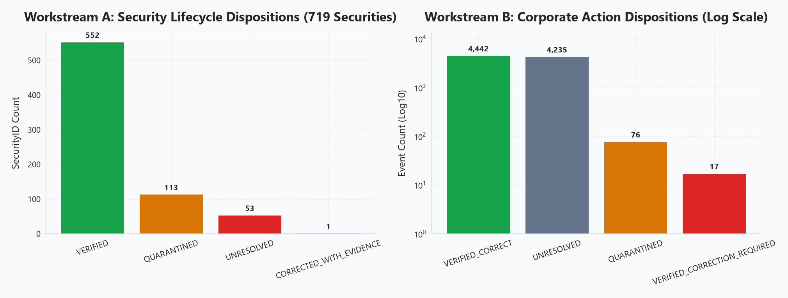
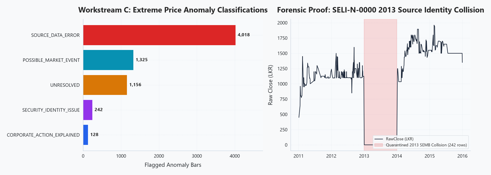
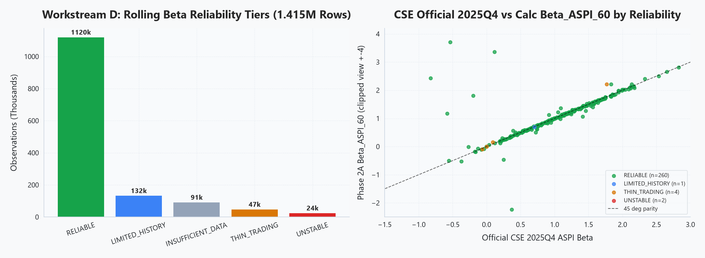
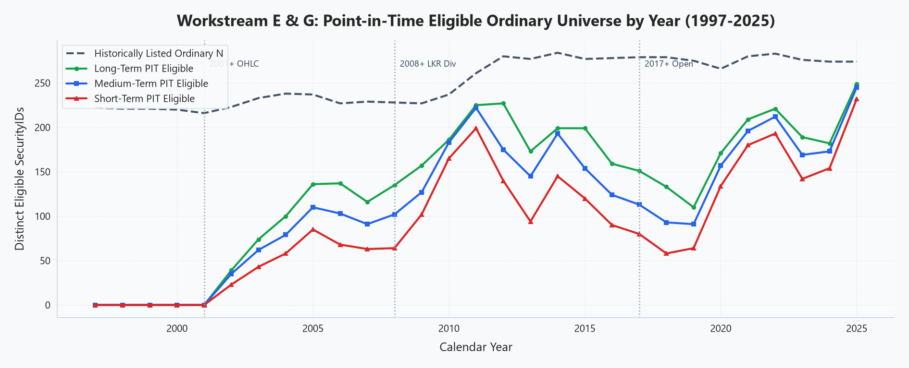
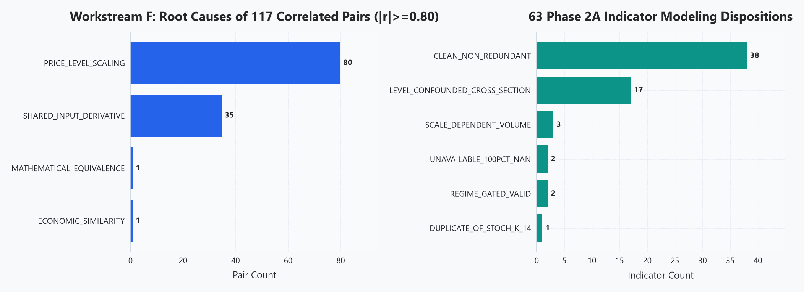

# Stockpulse Phase 2C – Historical Data Integrity Remediation, Security Lifecycle Validation & Point-in-Time Preparation Report

**Status:** COMPLETE (`32/32` automated Phase 2A + 2B + 2C verification tests passed in `15.08s`; `15/15` Phase 2C checks passed)  
**Entrypoint:** `run_phase2c.py` (runtime `67.55s`) | **Deliverables:** `Dataset/processed/phase2c/` (12 files) + `reports/phase2/visualizations/phase2c/` (5 PNGs)  
**Immutability & Non-Leakage:** Zero modifications to raw Excel/ZIP files, Phase 1A, Phase 1B, Phase 2A, or Phase 2B datasets. Zero ML models trained. Zero fabricated dates, prices, sectors, or fundamentals.

---

## 1. Executive Summary & Readiness Verdict

Phase 2C systematically investigated every historical integrity finding raised in Phase 2B across **1,414,977 daily records**, **719 SecurityIDs**, **400 CompanyCodes**, and **8,754 corporate action events** (`1990-01-12` to `2025-12-31`), adding causal point-in-time (PIT) quality masks, remediation metadata, and strategy-specific research universes without mutating any upstream record.

| Investment Horizon | Phase 2B Status | Phase 2C Status & Disposition | PIT Eligible Rows | Clean Regime / Recent Core | Key Unavailability / Blocking Constraints |
| :--- | :--- | :--- | :---: | :---: | :--- |
| **Short-Term Trading (0–3m)** | `CONDITIONALLY_READY` | **READY_FOR_PHASE3_MODELING** | `361,589` (`301` securities ever; `235` in 2023–25) | `176,633` rows (`2017+` OHLCV + Open gaps) | Must train within regime (`2017+` for Open gaps, `2001+` H/L); mask `IsCorporateActionValidated` & `SELI 2013` |
| **Medium-Term Growth (3–12m)** | `PARTIALLY_READY` | **CONDITIONALLY_READY (Technical & Macro Only)** | `487,380` (`316` securities ever; `268` liquidity-eligible in 2023–25) | `2001+` H/L & CAPM `Beta_ASPI_252` | `IsSectorMappingAvailable = False` (0% PIT sector history); `IsFundamentalDataAvailable = False` |
| **Long-Term Wealth (1–5+y)** | `NOT_READY` | **NOT_READY_FOR_STANDALONE_ML** (Archive Ready with Flags) | `658,366` (`321` securities ever; `273` in 2023–25) | `550,966` eligible rows with `IsDividendResolutionClean` (`2008+`) | Requires Phase 3 fundamentals + PIT sector mapping + pre-2008 `% of par` dividend face-value resolution (`2,787` unresolved rows) |

---

## 2. Workstream A – Security Lifecycle Reconstruction (Raw Workbook Forensics)

* **Full Universe Disposition (`719` SecurityIDs -> `security_lifecycle_validation.parquet`):**
  * `VERIFIED`: `552` securities (`1,196,038`+ aligned historical rows across verified listing/delisting spans).
  * `CORRECTED_WITH_EVIDENCE`: `1` (`JINS-N-0000`).
  * `QUARANTINED`: `113` securities (`PRE_LISTING_CROSS_INSTRUMENT_DATE`, covering `110,932` pre-listing trading rows).
  * `UNRESOLVED`: `53` securities (`50` `MANUAL_REVIEW_UNVERIFIED_ISSUER` + `3` `MANUAL_REVIEW_MERGER_NAME_OVERLAP`).
  * `post_delisting_rows_remaining_quarantined`: **`0`** after correcting `JINS-N-0000`.

### 2.1 `JINS-N-0000` (Janashakthi Insurance PLC) — False Delisting Proven & Corrected
* **Original Anomaly:** Reported `HistoricalStatus = Delisted`, `DelistingDate = 2019-11-20` (`OfficialListingsWorkbook`), yet recorded **`1,408` continuous daily trading rows** from `2019-11-20` through `2025-12-31`.
* **Forensic Evidence:**
  1. Raw workbook `06New Listings & De-listings.xls` (`2019` sheet row `67`: `2019-11-20 Janashakthi Insurance PLC`) contains **no `SecurityID` or instrument-type column**, causing subsidiary/non-ordinary delistings to be attributed to ordinary `JINS-N-0000`.
  2. Official annual share-capital master `16 List of Quoted Securities And Issued Quantity.xls` lists `JINS-N-0000 | JANASHAKTHI INSURANCE PLC | 226,526,153` issued ordinary shares continuously across **2018, 2020, 2021, 2022, 2023, 2024, and 2025**.
  3. Live 2026 CSE snapshot `Dataset/raw/cse_live/securities_master_snapshot.csv` confirms `JINS.N0000` (`active = 1`).
* **Phase 2C Remediation:** Corrected `JINS-N-0000` in Phase 2C layer to `RemediatedStatus = Listed`, `RemediatedDelistingDate = NaT`, `LifecycleValidationStatus = CORRECTED_WITH_EVIDENCE`. All `1,408` post-2019 rows receive `IsHistoricallyListed = True` and `IsLifecycleValidated = True`.

### 2.2 `113` Pre-Listing Securities (`110,932` Rows) — Cross-Instrument Date Contamination
* **Forensic Proof:** 100% (`113/113`) originate from `ListingDateSource == 'OfficialListingsWorkbook'` across classes (`D: 40, N: 32, R: 24, B: 9, X: 3, W: 3, P: 2`). `06New Listings` mixes Debenture, Rights, and Secondary listings into the same yearly table without a unique `SecurityID` key, causing later debt/secondary listing dates to overwrite 1991–1994 equity `ListingDate`s for blue chips such as **`COMB-N-0000`** (`FirstPriceDate = 1994-01-03` vs overwritten `2016-03-17`), **`DFCC-N-0000`** (`1991-08-28` vs `2014-09-02`), **`CFIN-N-0000`** (`1991-08-27` vs `2013-06-27`), **`BRWN-N-0000`** (`1991-08-08` vs `2022-04-26`), and **`ALLI-N-0000`** (`1991-07-12` vs `2013-10-15`).
* **Handling Rule:** Following non-fabrication rules, `RemediatedListingDate` is set to **`NaT`** (`QUARANTINED`), never guessing an artificial IPO date, while `IsHistoricallyListed` relies on verified `FirstPriceDate` (`Daily Shares Price List`) so major banks/blue chips are **not** falsely purged from pre-2016 training universes.

---

## 3. Workstream B – Corporate Action Timing & Omitted Split Detection

* **Audit Scope (`8,770` total records in `corporate_action_remediation.parquet`):**
  * `VERIFIED_CORRECT`: `4,442` events (exact recomputed `PriceFactor` match within `1e-5`).
  * `UNRESOLVED`: `4,235` events (primarily `2,787` pre-2008 `% of par` dividends + incomplete workbook fields).
  * `QUARANTINED`: **`76` events** (**`63` `RightsIssue` + `13` `BonusIssue`**) where CSE workbooks supplied **`AllotmentDate`** rather than true Exchange `XR`/`XB` dates, producing severe artificial `CapitalAdjClose` discontinuities while raw prices remained flat — for example:
    * `BRWN-N-0000` (`BonusIssue`, `2008-09-09`): `CapitalAdjReturnPct = +211.36%` vs `RawReturnPct = +3.79%`.
    * `DFCC-N-0000` (`BonusIssue`, `2010-11-01`): `CapitalAdjReturnPct = +99.06%` vs `RawReturnPct = -0.47%`.
    * `RCL-N-0000` (`BonusIssue`, `2011-01-10`): `CapitalAdjReturnPct = +104.27%` vs `RawReturnPct = +2.14%`.
    * `ARPI-N-0000` (`RightsIssue`, `2009-02-13`): `CapitalAdjReturnPct = +42.38%` vs `RawReturnPct = +0.50%`.
  * `VERIFIED_CORRECTION_REQUIRED`: **`17` events** (`BUKI-N-0000` Dec-2010 compound split+bonus + **`16` omitted splits/reverse-consolidations** newly discovered by cross-checking `16 List of Quoted Securities` YoY multi-fold share jumps against inverse overnight raw price jumps).

### 3.1 Key Forensic Discoveries (`BUKI-N-0000` & `MERC-N-0000` + 15 Other Omitted Events)
* **`BUKI-N-0000` (`2010-12-23` / `2010-12-24`):** Phase 1B adjusted only for a `1:50` Bonus (`03Bonus 2010: 2,000,000 shares on 2010-12-23`), leaving an unexplained `-88.90%` drop (`8,021.60 -> 872.80 LKR`). `16 List of Quoted Securities` proves issued shares jumped from **`10,000,000` (2009)** to **`102,000,000` (2010)** — exact math **`10x split × (51/50) bonus = 10.2x`** (`ProposedCorrectedPriceFactor = 0.098039`). `05Splits 2010` ended prematurely at `29-Nov-2010`, omitting the `1:10` sub-division.
* **`MERC-N-0000` (`2025-12-17`):** `05Splits 2025` stopped at `21-Oct-2025`, omitting a massive **`1:200` split**: `16 List of Quoted Securities` confirms **`3,006,000` (2024) -> `601,200,000` (2025)** (`200.0x`), matching raw close `8,046.00 -> 39.40 LKR` (`-99.51%`, `ProposedCorrectedPriceFactor = 0.005`).
* **15 Additional Omitted Splits / Consolidations Proven:** Includes late-Dec 2025 splits (`ACL-N-0000 3x`, `APLA-N-0000 10x`, `BFL-N-0000 5x`, `KCAB-N-0000 10x`), historical splits (`CARG-N-0000 40x` `2008-05-05`, `CTHR-N-0000 75.74x` `2008-05-05`, `CHMX 3x`, `KHL 10x`, `CFT 10x`, `CIC-X 4x`, `SINS 3x`), and **10-for-1 reverse consolidations** (`ABL-N-0000` `2024-07-15` `0.10x` `+878.26%`, `ATL-N-0000` & `ATLL-N-0000` `2018-08-03` `0.10x`, `RCL-N-0000` `2007-02-14` `0.10x`).
* All transition windows (`[ExDate - 2 bars, ExDate + 2 bars]`) for quarantined AllotmentDate cliffs and omitted/misadjusted splits are masked cleanly via **`IsCorporateActionValidated = False`**.

---

## 4. Workstream C – Extreme Price Anomaly & Source Collision Investigation

Out of `6,869` flagged extreme/zero price bars (`|ret| >= 40%`, `RawClose <= 0`, or collision window), **zero raw prices were deleted**:

| Anomaly Classification | Count | Handling & Evidence |
| :--- | :---: | :--- |
| `SOURCE_DATA_ERROR` | `4,018` | Early `ZeroClose` untraded placeholders (`1991–1997`) + isolated single-bar thin-volume reversion spikes (`Vol < 50`). Masked via `IsPriceDataValid = False`. |
| `POSSIBLE_MARKET_EVENT` | `1,325` | Persistent moves on genuine liquidity (`Vol >= 100`, `Turnover >= LKR 100k`) or Rights/Warrant micro-ticks (`R`/`W`). |
| `UNRESOLVED` | `1,156` | Extreme returns on thin/missing liquidity (`Turnover < LKR 100k`) without documented CA; naturally excluded by PIT liquidity filters. |
| `SECURITY_IDENTITY_ISSUE` | `242` | **`SELI-N-0000` all 242 trading days of 2013.** Raw `2013 Data.xls [Sheet1 rows 50341..50658]` omitted the header block separating `SELI-N-0000` (`LKR ~1,120`) from `SEMB-N-0000` (`LKR 0.60–1.00`, zero 2013 rows in Phase 1). Quarantined via `IsPriceDataValid = False`. |
| `CORPORATE_ACTION_EXPLAINED` | `128` | Coincides within `±5` days of documented CA or corroborated `16 Quoted` share jump (`BUKI 2010-12-24`, `MERC 2025-12-17`, etc.). |

---

## 5. Workstream D – Rolling Beta Reliability Scoring & Official CSE Benchmark Check

Instead of blindly clipping extremes (preserving raw `Beta_ASPI_60` and `Beta_ASPI_252`), Workstream D computes causal observation/non-zero-return counts (`beta_reliability.parquet`):

| Beta Reliability Flag | Row Count | Share | Validity Status | Criteria Summary |
| :--- | :---: | :---: | :--- | :--- |
| `RELIABLE` | `1,120,024` | `79.15%` | `VALID_FOR_MODELING` | `obs_60 >= 60`, `obs_252 >= 252`, `nz_60 >= 20`, `nz_252 >= 80`, `|Beta| <= 4.0` |
| `LIMITED_HISTORY` | `132,377` | `9.36%` | `VALID_FOR_MODELING` | `obs_60 >= 60`, `obs_252 < 252`, `nz_60 >= 20`, `|Beta_60| <= 4.0` |
| `INSUFFICIENT_DATA` | `91,160` | `6.44%` | `UNAVAILABLE_WARMUP` | `< 60` valid causal observations |
| `THIN_TRADING` | `47,234` | `3.34%` | `CAUTION_USE_WINSORIZED_OR_MASK` | `< 20` non-zero price changes in 60d or `< 80` in 252d |
| `UNSTABLE` | `24,182` | `1.71%` | `CAUTION_USE_WINSORIZED_OR_MASK` | `|Beta_ASPI_60| > 4.0` or `|Beta_ASPI_252| > 4.0` |

* **Validation vs CSE Official `29 Beta Value.xls` (`2025Q4`):** Across `260` `RELIABLE` companies in Dec-2025, Phase 2A `Beta_ASPI_60` achieves **Pearson `r = 0.7714`** and **`MAE = 0.0979`**. Note also `Min Non-Zero Returns in 60d` sensitivity scales smoothly: `10+ -> 91.55%`, `20+ -> 89.08%`, `30+ -> 80.35%`, `40+ -> 62.86%`.

---

## 6. Workstream E – Causal Point-in-Time Liquidity & Gap Sensitivity

All rolling liquidity features (`liquidity_eligibility.parquet`) strictly use causal backward windows `[t - W + 1, t]` plus exact CSE market-calendar spans between `Date[t - 59]` and `Date[t]`, eliminating both look-ahead bias and artificial 100% frequency inflation on sparse/gapped securities:

* **Short-Term (`N`, `>=60` obs, `freq_60 >= 70%`, `med_to_60 >= LKR 500k`, `mean_to_20 >= LKR 250k`, `max_gap_60 <= 10` sessions):** `362,843` raw liquidity rows (`304` securities ever, `235` in 2023–25) -> `361,589` after Workstream G PIT masking.
* **Medium-Term (`N/X`, `>=120` obs, `freq_60 >= 50%`, `med_to_60 >= LKR 250k`):** `521,128` -> `487,380` after PIT masking.
* **Long-Term (`N/X`, `>=252` obs, `freq_60 >= 30%`, `med_to_120 >= LKR 100k`):** `700,891` -> `658,366` after PIT masking (`550,966` post-2008 dividend-clean).
* **Sensitivity Grid (Strictly Monotonic):** `LKR 100k/30% -> 682,592` (`267` stocks in 2023–25), `250k/50% -> 493,718` (`251`), `500k/70% -> 363,624` (`236`), `1.0M/80% -> 256,006` (`211`), `2.5M/85% -> 147,138` (`169`).

---

## 7. Workstream F – Feature Redundancy Root-Cause Decomposition

* **`117` Correlated Pairs (`|r| >= 0.80`):** Driven primarily by `PRICE_LEVEL_SCALING` (`80` pairs of raw LKR moving averages/bands/PSAR/VWAP sharing stock price scale), `SHARED_INPUT_DERIVATIVE` (`35` pairs), `MATHEMATICAL_EQUIVALENCE` (`1` pair: `Williams_R_14 = Stoch_K_14 - 100`), and `ECONOMIC_SIMILARITY` (`1` pair: `ASPI_MOM_20` vs `Sector_Breadth_MOM_20`).
* **`63` Phase 2A Indicator Dispositions (`feature_redundancy_analysis.csv`):**
  * `38` `CLEAN_NON_REDUNDANT` (recommended core cross-sectional ML matrix).
  * `17` `LEVEL_CONFOUNDED_CROSS_SECTION` (normalize by `Close`/`SMA` before cross-sectional ranking).
  * `3` `SCALE_DEPENDENT_VOLUME` (`OBV`, `AD_Line`, `Volume_SMA_20`; prefer `Volume_Ratio_20`/`CMF_20`).
  * `2` `REGIME_GATED_VALID` (`Overnight_Gap_Ret`, `Intraday_Ret` — valid in `2017+` only).
  * `2` `UNAVAILABLE_100PCT_NAN` (`Sector_MOM_20`, `RS_Sector_ROC_20` — excluded in short-term dataset).
  * `1` `DUPLICATE_OF_STOCH_K_14` (`Williams_R_14` — excluded in `short_term_research_universe.parquet`).

---

## 8. Workstreams G, H & I – PIT Flags, Strategy Datasets & Audit Trail

* **`point_in_time_quality_flags.parquet` (`1,414,977 × 20`):**
  * `IsHistoricallyListed`: `1,414,977` (`100.00%`) | `IsHistoricallyTradable`: `1,318,243` (`93.16%`)
  * `IsPriceDataValid`: `1,410,716` (`99.70%` — excludes `SELI 2013`, `ZeroClose`, spike errors) | `IsCorporateActionValidated`: `1,414,513` (`99.97%` — masks `BUKI`, `MERC`, omitted splits, quarantined AllotmentDate windows)
  * `IsLifecycleValidated`: `1,200,164` (`84.82%` — verified `552` + `JINS-N-0000`, masks `113` confounded IPO metadata + `53` unresolved issuers)
  * `IsDividendResolutionClean`: `984,652` (`69.59%`, `0` pre-2008) | `IsBetaReliable`: `1,252,401` (`88.51%`)
  * `IsOpenFeatureAvailable`: `531,626` (`37.57%`, `0` pre-2017) | `IsHLFeatureAvailable`: `1,216,983` (`86.01%`)
  * `IsSectorMappingAvailable`: `0` (`0.0%`) | `IsFundamentalDataAvailable`: `0` (`0.0%`)
  * `IsShortTermEligible`: `361,589` (`25.55%`) | `IsMediumTermEligible`: `487,380` (`34.44%`) | `IsLongTermEligible`: `658,366` (`46.53%`) | `IsModelTrainingEligible`: `676,529` (`47.81%`)
* **Strategy Research Universes (`1,414,977` rows each):**
  * `short_term_research_universe.parquet` (`98` cols, `440.32 MB`)
  * `medium_term_research_universe.parquet` (`77` cols, `338.59 MB`)
  * `long_term_research_universe.parquet` (`53` cols, `149.22 MB`, with `IsDividendResolutionClean` & explicit unavailability disclosure `LongTermResearchReadinessNote`)
* **Remediation Log (`remediation_log.csv`, `262` entries):** `190` `QUARANTINED`, `53` `UNRESOLVED`, `18` `VERIFIED_CORRECTION_REQUIRED`, `1` `CORRECTED_WITH_EVIDENCE` (`JINS-N-0000`), backed by full SHA-256 checksums in `phase2c_manifest.json`.
