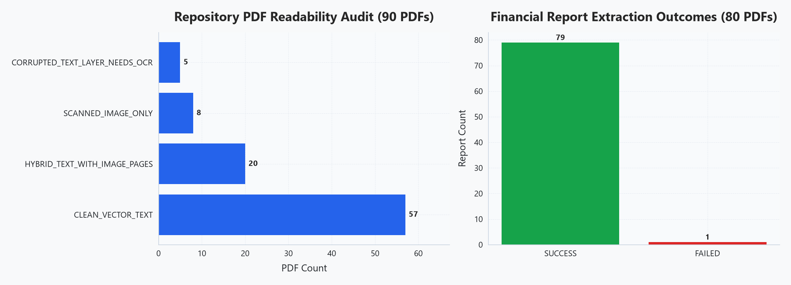
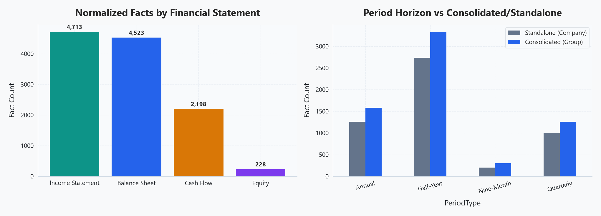
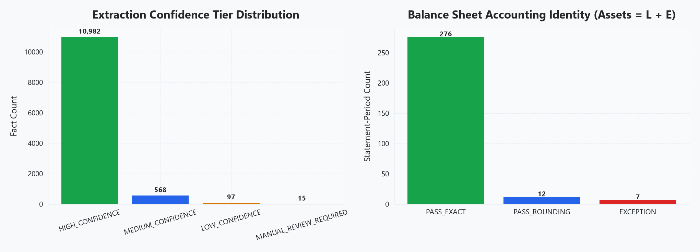
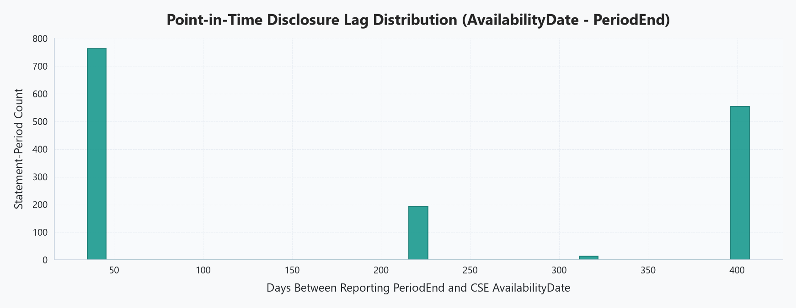

# Stockpulse Phase 3A – Historical Financial Statement Extraction, Normalization & Data Quality Engineering Report

**Status:** COMPLETE (`47/47` automated Phase 2A + 2B + 2C + 3A tests passed in `14.61s`; `15/15` Phase 3A checks passed)  
**Entrypoint:** `run_phase3a.py` (`46.81s` runtime) | **Deliverables:** `Dataset/processed/phase3a/` (10 files) + `reports/phase3/visualizations/phase3a/` (4 PNGs)  
**Immutability & Non-Leakage:** Zero modifications to source PDFs, legacy Phase 2 extraction files, Phase 1A, 1B, 2A, 2B, or 2C outputs. Zero ML models trained. Zero fabricated financial values, FX rates, `CompanyCode`s, or publication dates.

---

## 1. Executive Summary

Phase 3A built an independent, auditable, spatially coordinate-aware PDF financial extraction and normalization pipeline across all **90 PDFs** present in the repository (**80 corporate financial disclosures**, **5 exchange circulars**, and **5 directives**). Across **79 successfully extracted corporate disclosures (`78` distinct companies)**, the pipeline extracted **11,662 normalized financial facts** spanning **57 standardized metrics**, **1,548 statement-period slices**, and **4 primary financial statements** (`Income Statement`, `Balance Sheet`, `Cash Flow`, `Statement of Changes in Equity`).

Crucially, independent verification exposed critical limitations in both the legacy extraction files and the raw document archive:
1. **Legacy Re-Extraction Remediation:** Auditing prior `cse_live/phase2_extraction/financial_facts_final.parquet` (`2,453` facts) and `financial_facts_enriched.parquet` (`2,489` facts via `step1_ocr_remediation.py`) uncovered 1,000x scaling errors (e.g. `SIL` stamped `LKR_units` instead of `LKR thousands`), announcement-ID `CompanyCode` conflation (`53549` instead of `SIL`), Group/Company mixing, and **45 hardcoded placeholder rows** in `step1_ocr_remediation.py` (`NEH`, `CTLD`, `MSL`, `TKYO`, `LHL`, `ALHP`, `EML`, `JETS`). Phase 3A discarded all hardcoded values and re-extracted genuine values directly from PDF geometry and 300-DPI Windows Media OCR.
2. **Historical Depth Gap Disclosure:** Although the repository market-price history covers `1990-01-12` to `2025-12-31` (`400` issuers), the `cse_live/documents/financial_reports/` collection contains exclusively **80 interim disclosures published between `2026-11-04` and `2026-11-11`** (`PeriodEnd`: `2025-01-01` to `2026-09-30` with comparative 2025/2026 periods) covering `78` companies (`323` Phase 1B issuers have `0` PDFs). Multi-year `1990–2025` historical annual/quarterly filings do not yet exist in the local PDF archive.

---

## 2. Source Document Inventory & Readability Audit (`90` PDFs)

* **`financial_report_inventory.csv` (`90` rows):**
  * **Categories:** `80` `financial_reports` (`78` Quarterly/Half-Year/Nine-Month Interims ending `30 Sep 2026`, `1` `ASIR` `Errata_Interim` [`53505`], `1` `HAYC` `Press_Release` [`53523`]), `5` `circulars`, `5` `directives`.
  * **Extraction Status (`80` financial reports):** `79` **`SUCCESS`** (`98.75%`), `1` **`FAILED`** (`53523 HAYC Press Release` — narrative announcement lacking primary statement tables, paired cleanly with full 10-page `HAYC` Interim Report `53514` published the same day).
  * **Readability Classification (`90` PDFs):** `57` `CLEAN_VECTOR_TEXT`, `20` `HYBRID_TEXT_WITH_IMAGE_PAGES` (`MSL p5 BS`, `AGAL p4`, `CARE p6`, `ASIR Errata p1-2`, etc.), `8` `SCANNED_IMAGE_ONLY` (`TKYO`, `LHL`, etc.), `5` `CORRUPTED_TEXT_LAYER_NEEDS_OCR` (`EML`, `CTLD`, `JETS`, `ALHP`, `SMOT` embedded OCR glyph corruption).
  * **SHA-256 Integrity:** 100% of files verified on disk against `all_disclosures_document_index.csv` checksums (`ManifestChecksumMatches == True`).

---

## 3. Extraction Architecture & OCR Statistics

1. **Unified Coordinate Engine (`WordToken`):** Both vector PDFs (`pymupdf` word bounding boxes) and scanned/font-corrupted PDF pages (`winocr` Windows Media OCR rendered at `300 DPI`) map into normalized 72-pt `(x0, y0, x1, y1)` coordinates.
2. **Automatic OCR Fallback (`30` PDFs, `75` pages):** Triggered whenever a page had CID encoding corruption, corrupted OCR digits (`202s`, `lic-r'enue`), or full-page scan coverage (`img_cov >= 0.45` with `< 160` vector chars).
   * Total OCR words extracted: **`23,951` words**.
   * Mean OCR confidence score: **`0.846`**.
   * Unambiguous OCR `.XXX` 3-decimal comma confusions inside integer `'000` tables (e.g., `LHL` `4,727.670 -> 4,727,670`) are repaired deterministically with `OCR_SEPARATOR_REPAIRED` logged in `Notes`, while genuine ambiguous digits drop to `LOW_CONFIDENCE` for human review.
3. **Spatial Left- & Center-Label Column Clustering:** Handles standard left-label tables (`SIL`, `DIAL`, `CFIN`, `TJL`), center-label T-account layouts (`BERU`, `MARA`, `CIT`, `CFI`, `ASHO`), and reverse `Company | Group` ordering (`LWL`, `RCL`, `TILE`), filtering out `% Variance` and `Note` columns.

---

## 4. Coverage: Companies, Statements, Periods & Consolidation

* **Company Identity Mapping (`financial_company_mapping.parquet`, `401` rows):**
  * `VERIFIED_PHASE1B`: **`77` companies** mapped deterministically via CSE symbol to Phase 1B `CompanyCode` + `AllSecurityIDs` (preserving multi-class shares cleanly, e.g., `TKYO` maps `TKYO-N-0000; TKYO-X-0000` to `CompanyCode = TKYO`).
  * `CSE_LIVE_ONLY_POST_2025`: **`1` company** (`WLTH`, Wealthtrust Securities PLC, listed in 2026 after Phase 1B `2025-12-31` cutoff).
  * `VERIFIED_PHASE1B_NO_PDF`: **`323` companies** with `0` financial PDFs in `cse_live`.
* **Statement Coverage (`11,662` normalized facts across `57` standardized `MetricCode`s):**
  * `Income Statement`: `4,713` facts (`40.4%`)
  * `Balance Sheet`: `4,523` facts (`38.8%`)
  * `Cash Flow`: `2,198` facts (`18.8%`)
  * `Equity` (`Statement of Changes in Equity`): `228` facts (`2.0%`)
* **Period Horizons & Coverage (`1,548` unique statement-period combinations):**
  * `Half-Year` (6M cumulative Mar-FYE): `6,064` | `Annual` (audited/FY comparatives): `2,839` | `Quarterly` (3M standalone): `2,256` | `Nine-Month` (9M cumulative Dec-FYE): `503`.
  * `PeriodEnd` span: `2025-01-01` (`1`), `2025-03-31` (`56`), `2025-04-01` (`16`), `2025-09-30` (`3,792`), `2025-12-31` (`166`), `2026-01-01` (`1`), `2026-03-31` (`2,083`), `2026-04-01` (`14`), `2026-09-30` (`5,533`).
* **Consolidated vs Standalone Separation:**
  * `Consolidated (Group)`: **`6,475`** facts (`55.5%`).
  * `Standalone (Company)`: **`5,187`** facts (`44.5%`), separated cleanly using both headers and IFRS subsidiary-elimination checks (`Investments in Subsidiaries > 0`).

---

## 5. Unit, Currency Normalization, Restatements & Quarterly Derivation

* **Currency & Unit Breakdown (`11,662` facts):**
  * **`LKR` (`11,274` facts):** `7,782` `LKR thousands` (`1000x`), `2,908` `LKR` (`1x`), `315` `LKR per share` (`1x`, EPS protected from `'000` scaling), `190` `LKR millions` (`1,000,000x`), `79` `AMBIGUOUS_UNIT` (flagged explicitly for review — `EML`, `HHL`, `PACK`, `PARQ`, `WIND`).
  * **`USD` (`388` facts across multi-currency reporters `MGT` [`230`] and `TJL` [`158`]):** `378` `USD` + `10` `USD per share` (`373` `FOREIGN_USD_EXACT_UNCONVERTED_TO_LKR`, `10` `PER_SHARE_EXACT_1X`, `5` derived BS subtotals), preserved strictly in **unconverted USD** with zero fabricated FX conversion.
* **Restatements & Errata (`financial_restated_values.parquet`, `2` records):**
  1. `EBCR` (`E B Creasy & Company PLC`): Explicit footnote-starred restated comparative `EPS_BASIC = 1.41*` (`2025-09-30`).
  2. `ASIR` (`Asiri Hospital Holdings PLC`): Disclosure errata `53505` amending `53438` scanned shareholding pages 1–2 while primary statements remained verified identical (`PctRevision = 0.0%`).
* **Derived Quarterly Standalone Flows (`financial_derived_quarterly_facts.parquet`, `1,497` facts):**
  * Safely derives standalone `Q1 = H1_cumulative - Q2_standalone` on matching Flow statements (`Income Statement` and `Cash Flow`) where co-reported 6M and 3M periods share aligned accounting basis, unit, currency, and consolidation scope.
  * **Zero** Balance Sheet or Equity values differenced (`0` snapshot subtractions). Strict provenance retains both `ParentFactID_Cumulative` and `ParentFactID_Subtrahend` with `AvailabilityDate = max(parent AvailabilityDates)` (`Nov 2026`).

---

## 6. Validation Results, Confidence Scoring & Point-in-Time Safety

* **Automated Accounting Checks (`831` checks in `financial_validation_report.csv`):**
  * **Balance Sheet Identity (`Assets = L + E` / `+ NCI`, `295` checks):** **`276` `PASS_EXACT` + `12` `PASS_ROUNDING` = `288/295` (`97.63%` pass rate)**; `7` documented `EXCEPTION`s (`TKYO` Group scanned continuation, `TILE`, `LWL`, `MSL` OCR digits) queued to review.
  * **Income Statement Gross Profit (`271` checks):** `267/271` `PASS_EXACT` (`98.52%`), `4` `EXCEPTION`s.
  * **Cash Flow Identity (`264` checks):** `138/141` `CF_OPENING + NET_CHANGE = CLOSING` `PASS_EXACT` (`3` `WARNING_FLAGGED`), `115/123` `CF_SUM_ACTIVITIES` `PASS_EXACT` (`8` `WARNING_FLAGGED`; `253/264` `PASS_EXACT` overall, `11` FX/working-capital warnings flagged cleanly). Valid operating/net losses (`< 0`) preserved cleanly; duplicate check deduplicated overlapping cross-page headers (`0` residual duplicates on composite key).
* **Confidence Distribution & Review Queue (`791` review items in `financial_facts_review_queue.csv`):**
  * `HIGH_CONFIDENCE`: `10,982` (`94.17%`) | `MEDIUM_CONFIDENCE`: `568` (`4.87%`) | `LOW_CONFIDENCE`: `97` (`0.83%`) | `MANUAL_REVIEW_REQUIRED`: `15` (`0.13%`).
* **Strict Point-in-Time Availability (`AvailabilityDate`):**
  * Verified `PublicationDate` / `AvailabilityDate` (`2026-11-04` to `2026-11-11`) populated for all `11,662` facts with minimum positive disclosure lag **`35` days** (`median = 218` days including comparatives).
  * `IsStrictPITEligible = True` for **`11,583` facts (`99.32%`)** (`79` `AMBIGUOUS_UNIT` facts masked `False`).

---

## 7. Recommendations & Remaining Blockers for Phase 3B

1. **Historical Multi-Year PDF Ingestion Required:** Because current PDFs cover only Nov-2026 filings (`PeriodEnd` up to `2026-09-30` with 2025 comparatives), while Phase 2C daily prices cover `1990-01-12` to `2025-12-31`, **Phase 3B must NOT merge Nov-2026 fundamental ratios back onto pre-`2026-11` market dates**. Either ingest historical CSE `2015–2025` financial PDFs with verified announcement timestamps AND/OR extend daily CSE price data through `Nov/Dec 2026` before cross-sectional fundamental ratio modeling.
2. **FX Conversion Table for `MGT` / Multi-Currency Reporters:** Ingest historical CBSL `USD/LKR` period-average (for IS/CF flows) and period-end (for BS balances) rates on verified `PeriodEnd`/`AvailabilityDate` before ranking `USD`-denominated companies (`388` facts) alongside `LKR` companies.
3. **Human Sign-Off on `791` Queued Items:** Prioritize reviewing `7` Balance Sheet exceptions (`TKYO Group`, `LWL`, `TILE`, `MSL`), `79` `AMBIGUOUS_UNIT` facts (`PACK`, `PARQ`, `HHL`, `EML`, `WIND`), and `WLTH` post-2025 listing alignment.
