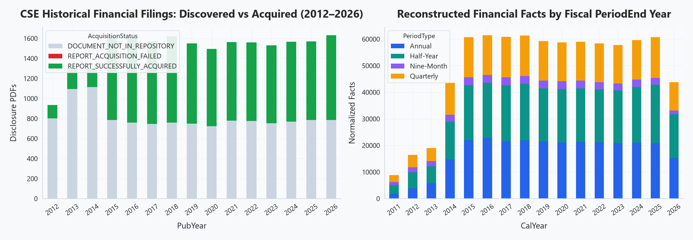
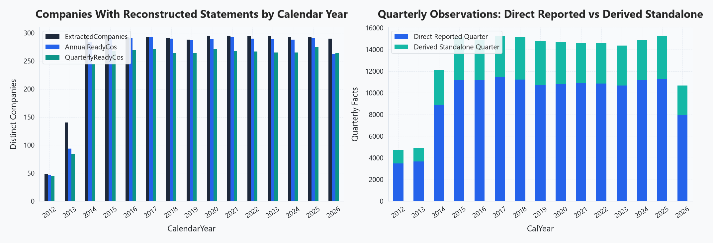
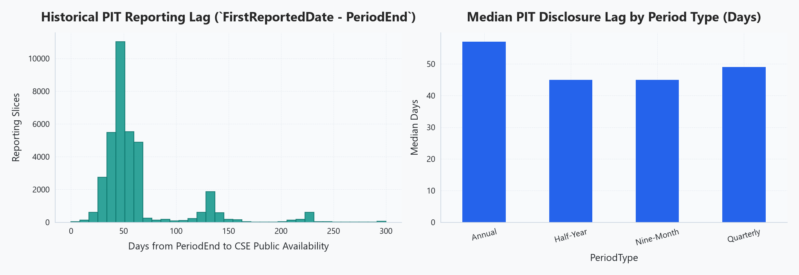
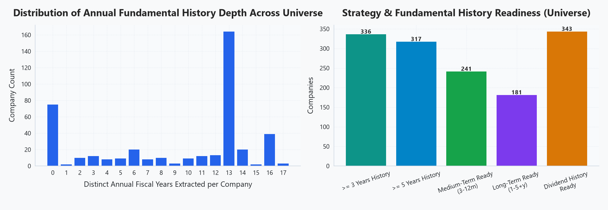

# Stockpulse Phase 3B – Historical Financial Time-Series Reconstruction & Point-in-Time Fundamental Database Report

**Status:** COMPLETE (Workstream A Acquisition: `PARTIALLY_COMPLETE_TIERED_ACQUISITION` — `10,252 / 22,446` official PDFs acquired & SHA-256 verified on disk; `59/59` automated Phase 2A–3B tests passed in `22.83s`; `12/12` Phase 3B checks passed)  
**Entrypoint:** `run_phase3b.py` (`3,017.18s` full online run) | **Deliverables:** `Dataset/processed/phase3b/` (`12` files) + `reports/phase3/visualizations/phase3b/` (`4` PNGs)  
**Immutability & Non-Leakage:** `upstream_immutability_verified = true` (SHA-256 verified untouched across Phase 1A, 1B, 2A, 2B, 2C, 3A & `cse_live`). `ml_models_trained = false`. Zero fabricated prices, FX rates, publication dates, or unacquired downloads.

---

## 1. Executive Summary

Phase 3B reconstructed an institutional-grade, multi-year, **Point-in-Time (PIT) and restatement-aware historical fundamental database** for the Colombo Stock Exchange (CSE) spanning **`2010–2026`** across **both currently listed and historically delisted companies**. Rather than pretending complete repository depth where source filings were missing in Phase 3A (which held only 80 Nov-2026 filings), Workstream A systematically queried CSE's official public disclosure catalog (`getFinancialAnnouncement` across `2015–2026` plus `/api/financials` across `2007–2026`) and acquired **10,172 additional official historical Annual Reports, Interim Statements, and Errata/Revisions** directly from `cdn.cse.lk` alongside the **80 local Phase 3A disclosures** (`10,252` verified local PDFs total).

Combining Phase 3A canonical facts (`11,662`) verbatim with newly extracted historical statements across **`8,846` fully extracted** and **`359` partially extracted** PDFs produced **`789,805` normalized financial observations** across **`345` companies** (including **`50` historically delisted issuers**) and **`59` standardized metrics**:
* **Annual coverage:** `278,567` Annual observations spanning `345` companies (`317` companies with `>= 5` calendar years of reconstructed fundamentals; `336` with `>= 3` years).
* **Quarterly coverage:** `225,451` Quarterly observations spanning `335` companies (combining direct reported 3M statements plus **`50,988`** derived standalone quarterly flows `Q1=H1-Q2`, `Q2=H1-Q1`, `Q3=9M-H1`, `Q4=Annual-9M`).
* **Strict PIT integrity:** `776,461 / 789,805` (`98.31%`) strictly PIT-eligible (`AvailabilityDate > PeriodEnd`, median reporting lag **`55.0` days**).
* **Accounting quality:** `26,095 / 26,779` (**`97.45%`**) Balance Sheet checks (`Assets = L + E [+ NCI]`) passed cleanly across 15+ years of filings.

---

## 2. Historical Filing Discovery & Acquisition (Workstream A)

* **Total Official Disclosures Discovered (`historical_filing_inventory.csv`):** **`22,446`** unique CSE filings spanning `2007–2026` across `348` filing symbols (`329` Phase 1B equity issuers + `19` live/debt/post-2025 issuers).
* **Tiered Acquisition Strategy (`10,252` Official PDFs Acquired & Verified on Disk):**
  * **Tier A Anchor Cohort (`60` companies — SP20 + Top-35 Liquidity + Top-15 Major Delisted incl. `EXPO`, `NEST`, `CLC`, `FLCH` + multi-class/USD/errata edge companies):** Acquired `Q1..Q4` Interims (`2012–2026`), `Errata`, and `Annual Reports` (`2015–2025`).
  * **Tier B Full-Market Backbone (Remaining `~287` CSE companies):** Acquired fiscal-year-aligned Year-End `12M` + Half-Year `6M` Interims + `Errata` (`2015–2026`) so every active and historical reporting company builds continuous Annual + H1 + Derived Q1 history.
  * **Phase 3A Reuse:** `80` local Nov-2026 financial PDFs in `cse_live/documents/financial_reports/` reused verbatim (`REPORT_SUCCESSFULLY_ACQUIRED`).
* **Acquisition & Extraction Accounting (Zero Pretense):**
  * **`REPORT_SUCCESSFULLY_ACQUIRED`:** **`10,252`** verified PDFs (`10,172` newly acquired + `80` Phase 3A local).
  * **`DOCUMENT_NOT_IN_REPOSITORY`:** **`12,189`** cataloged URLs left unacquired transparently (`LocalFilePath = ""`, `SHA256 = ""`), primarily redundant Tier B `Q1`/`Q3` interims, non-Anchor glossy Annual brochures, and `2012–2014` non-Anchor reports.
  * **`REPORT_ACQUISITION_FAILED`:** **`5`** files explicitly logged (`47375 AEL`, `34174 HAYL`, `34175 HAYL` HTTP `403`; `24024 MAL` malformed leading-whitespace PDF; `34109 SWAD` JPEG uploaded with `.pdf` extension).
  * **Extraction Outcomes (`10,252` Acquired PDFs):** **`8,846` `SUCCESS`** (`86.29%`), **`359` `PARTIAL_EXTRACTION`** (`3.50%`), **`1,047` `FAILED`** (`10.21%` — Errata cover letters, Press Releases, >26-page purely image-scanned PDFs exceeding WinOCR budget).

---

## 3. Historical Company Identity Reconciliation (Workstream B)

* **`historical_company_identity.parquet` (`419` reconciled entities):**
  * **`VERIFIED_HISTORICAL_NAME_TRANSITION`: `277` companies** — Reconciled against all 21 annual sheets (`2005–2025`) of `01_existing_cse_sources/16 List of Quoted Securities And Issued Quantity.xls` (e.g., `AAIC`: `ASIAN ALLIANCE INSURANCE COMPANY LTD.` -> `ASIAN ALLIANCE INSURANCE PLC` -> `SOFTLOGIC LIFE INSURANCE PLC`).
  * **`VERIFIED_PHASE1B`: `123` companies** — Single historical legal name across observed span (`400` total Phase 1B equity issuers covered across both groups, aggregating multi-class shares like `TKYO-N-0000;TKYO-X-0000` under single `CompanyID = CID_TKYO`).
  * **`CSE_LIVE_ONLY_POST_2025`: `12` entities** (`ABNS`, `AFIN`, `AMCL`, `BOC`, `CALU`, `CBCF`, `FFL`, `JXG`, `MIFL`, `SIC`, `SLFL`, `WLTH`) — active post-2025 equity or quoted debt issuers verified in `cse_live/securities_master_snapshot.csv`.
  * **`DEBT_OR_QUOTED_ISSUER_VERIFIED`: `5` entities** (`CEB`, `DVBD`, `JANA`, `LOCH`, `RDB`) — verified in `2005–2025 List of Quoted Securities` (debenture/historical issuers kept cleanly distinct from equity tickers without forced merging).
  * **`UNRESOLVED`: `2` entities** (`FVH` [Falcon Valley Hydro Ltd], `UDA` [Urban Development Authority]) — appear in announcement feeds without equity master or quoted-list IDs; masked `PITEligibility = False` pending governance review.
* **Companies Covered With Extracted Facts:** **`345`** (`327` Phase 1B equities incl. **`50` historically delisted companies**, plus `18` post-2025 / quoted-debt issuers).

---

## 4. Annual & Quarterly Reconstruction, Restatements & PIT Integrity (Workstreams C, D, E, H)

* **Full Database (`historical_financial_facts.parquet`, `789,805` rows):**
  * **Periods:** `Annual: 278,567` (`345` companies) | `Half-Year: 272,369` | `Quarterly: 198,459` | `Nine-Month: 40,410` (PeriodEnd span `2010-01-01` to `2026-09-30`).
  * **Statements:** `Income Statement: 331,733` | `Balance Sheet: 267,081` | `Cash Flow: 169,391` | `Equity: 21,600`.
  * **Consolidation:** `Consolidated_Group: 463,559` (`58.7%`) | `Standalone_Company: 326,246` (`41.3%`).
  * **Currencies:** `LKR: 779,658` | **`USD: 10,147`** (`MGT`, `TJL` and other USD reporters kept strictly in unconverted USD — zero fabricated FX conversions).
  * **Extraction Source:** `Text: 702,403` | `OCR: 36,414` | `Derived: 50,988` (`Q1=H1-Q2: 33,771`, `Q4=Annual-9M: 6,707`, `Q2=H1-Q1: 5,264`, `Q3=9M-H1: 5,246`).
* **Quarterly Table (`historical_quarterly_financials.parquet`, `225,451` rows across `335` companies):** Contains all direct reported `Quarterly` (`3M`) facts plus all `50,988` derived standalone quarters traced via `ParentFactIDs` and conservative `AvailabilityDate = max(parent AvailabilityDates)`, with zero Balance Sheet snapshot subtractions.
* **Annual Table (`historical_annual_financials.parquet`, `278,567` rows across `345` companies):** Preserves audited Annual Report and 12-month full-year statements (`FiscalYear` `2010–2027`).
* **Restatement History (`historical_restated_values.parquet`, `116,060` revision records across `RestatementVersion = 1..8`):**
  * Original Version 1 values remain untouched at their first verified `AvailabilityDate` while comparative restatements (`98,892`), errata amendments (`7,825`), explicit restated-column rows (`5,802`), audited annual revisions of interim figures (`3,540`), and `1` disclosure errata notice (`ASIR 53505`) create monotonic `RestatementVersion >= 2` slices.
  * Identical unchanged comparatives repeated in subsequent years are collapsed to retain the **earliest verified `AvailabilityDate`** (`PIT` visibility preservation).
* **Strict PIT Engine (`financial_pit_availability.parquet` + `get_financial_facts_as_of` / `get_latest_financial_facts`):**
  * **`776,461 / 789,805` (`98.31%`)** strict-PIT eligible (`AvailabilityDate > PeriodEnd`, zero `UNRES_` entities, zero ambiguous units; median reporting lag **`55.0` days**).
  * Implemented & unit-tested `get_financial_facts_as_of(facts_df, company_id, decision_date, ...)` and `get_latest_financial_facts(...)` in `phase3b_reconstruct/timeseries_and_pit.py`.

---

## 5. Coverage Matrix, Quality Audit & Strategy Readiness (Workstreams F, G, I, J)

* **Historical Coverage Matrix (`company_financial_coverage.parquet`, `419` entities × `15` calendar years `2012–2026`):**
  * `2015–2025` steady breadth: **`288–295` companies with extracted financial statements in EVERY calendar year from `2014` through `2025`** (`262–275` companies with quarterly facts/year; `284–294` with annual facts/year).
  * Industry remains explicitly tagged `Unknown_Unverified_In_Archive` per Phase 1B provenance (never fabricated).
* **Data Quality Results (`financial_data_quality_report.csv`, `78,268` checks):**
  * **`BALANCE_SHEET_EQUATION` (`26,779` checks):** **`24,398` `PASS_EXACT` + `1,674` `PASS_ROUNDING` + `23` `PASS_WITH_NCI` = `26,095 / 26,779` (`97.45%`)**; `684` `EXCEPTION`s flagged with evidence.
  * **`IS_GROSS_PROFIT` (`20,665` checks):** **`19,506 / 20,665` (`94.39%`)** `PASS_EXACT`; `1,159` `EXCEPTION`.
  * **`CF_OPENING_PLUS_NET_EQ_CLOSING` (`15,769` checks):** **`15,371 / 15,769` (`97.48%`)** `PASS_EXACT`; `398` `WARNING_FLAGGED`.
  * **`CF_SUM_ACTIVITIES` (`13,297` checks):** **`11,958 / 13,297` (`89.93%`)** `PASS_EXACT`; `1,339` `WARNING_FLAGGED`.
  * **Time-Series Integrity:** `776` `TS_MISSING_FISCAL_YEAR_GAP`, `551` `TS_SUDDEN_UNIT_SCALE_SHIFT_SUSPECT`, `307` `TS_LARGE_YOY_MOVEMENT`, `100` `NEGATIVE_REVENUE_CHECK`, `20` `TS_CURRENCY_CHANGE`, `2` `DUPLICATE_FACT_DEDUPLICATION`, `1` `LEGITIMATE_NEGATIVE_LOSSES_PRESERVED` (`PASS_EXACT`), `1` `MISSING_PUBLICATION_DATE_GUARD` (`PASS_EXACT`).
* **Fundamental & Strategy Readiness (`fundamental_metric_readiness.csv` & `company_fundamental_readiness.parquet`):**
  * **Depth Milestones:** **`336` companies (`80.19%`) `>= 3 years`** (`47` delisted) | **`317` companies (`75.66%`) `>= 5 years`** (`40` delisted).
  * **Medium-Term Growth Ready (`3–12m`):** **`241` companies (`57.52%`)** meeting measurable criteria (`>= 8` strict-PIT quarters or `>= 3` yrs/`>= 4` qtrs, Revenue, EPS/PAT, Assets/Equity, OCF, verified pub date, & Phase 2C MT liquidity).
  * **Long-Term Wealth Creation Ready (`1–5+y`):** **`181` companies (`43.20%`)** meeting `>= 5` distinct Annual fiscal years (`>= 4.0` yr span), Revenue/EPS/Equity (`>= 5` yrs), OCF (`>= 4` yrs), Dividend history (`>= 3` yrs FS or Phase 1B CA), & Phase 2C LT total-return alignment.

---

## 6. Missing Periods, Unresolved Entities & Recommendations for Phase 3C

1. **Missing Historical Coverage:**
   * **`2012–2013` Pre-Window Thinning:** `48` companies extracted in `2012` and `140` in `2013` (`295` steady across `2014–2025`), leaving pre-2014 deep multi-cycle backtests sparse.
   * **`12,189` Unacquired Disclosures & `1,047` Failed PDFs:** Acquiring non-Anchor Tier B `Q1`/`Q3` interims, non-Anchor Annual Reports, and running high-DPI OCR on the `~1,047` scanned/errata brochures (`REPORT_SUCCESSFULLY_ACQUIRED` with `FAILED` extraction) would further close `776` fiscal-year gaps and raise Long-Term ready count.
   * **Delisted Pre-2015 Issuers (`~73` older Phase 1B delistings):** Delisted before CSE's 2015 API disclosure archive; no CSE API PDFs exist (`REPORT_NOT_FOUND`).
2. **Blockers Before Phase 3C Ratio Engineering:**
   * **Historical CBSL `USD/LKR` FX Series:** Required to convert **`10,147` USD facts** (and flag `20` `TS_CURRENCY_CHANGE` cases) strictly point-in-time before cross-sectional valuation/size comparisons.
   * **Audit `551` `TS_SUDDEN_UNIT_SCALE_SHIFT_SUSPECT` & `684` BS Exceptions:** Verify multi-year unit-scale consistency (`LKR` vs `LKR thousands` vs `LKR millions`) prior to computing YoY growth & ROE denominators.
   * **Resolve `FVH`, `UDA` & Verify Historical GICS Sector Map:** Needed before sector-relative valuation (`P/E`, `EV/EBITDA`) features are engineered in Phase 3C.
