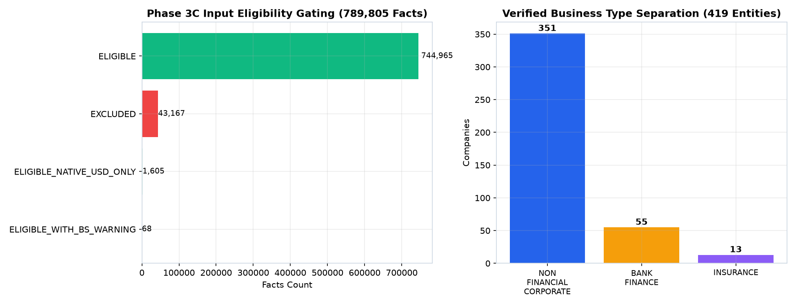
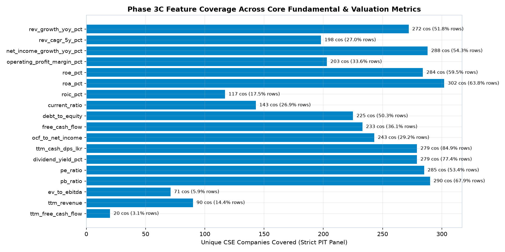
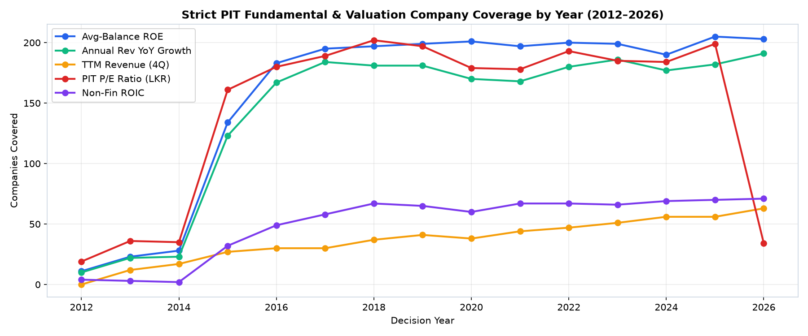
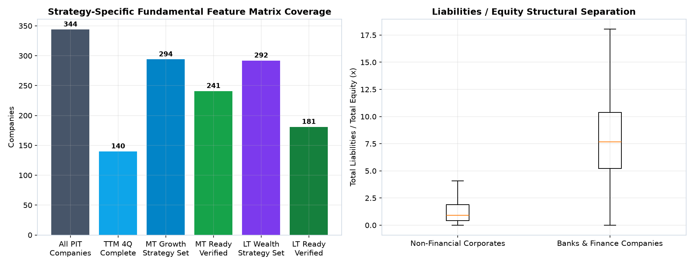

# Stockpulse Phase 3C – Fundamental Feature Engineering, Financial Quality, Growth & Valuation Metrics

**Report Date:** 2026-11-27  
**Pipeline Status:** **COMPLETE** (Strict Input Gating, Zero ML Training, Zero Upstream Mutations)  
**Primary Execution Script:** [`run_phase3c.py`](../../run_phase3c.py)  
**Feature Library:** [`phase3c_features/`](../../phase3c_features/__init__.py)  
**Test Suite:** [`tests/test_phase3c.py`](../../tests/test_phase3c.py) (`20/20` Phase 3C tests passing; `79/79` combined Phase 2A–3C tests passing)

---

## 1. Executive Summary

Phase 3C transforms the Phase 3B Colombo Stock Exchange (CSE) point-in-time historical fundamental database (`789,805` normalized financial facts across `345` extracted companies and `419` verified entities) into a clean, point-in-time (PIT) fundamental feature panel built for downstream medium-term (3–12 months) and long-term (1–5+ years) investment strategy research.

In accordance with Stockpulse's **Final Principle** (*"Never sacrifice financial accuracy to maximize feature coverage"*), Phase 3C establishes strict currency, unit-scale, balance-sheet reconciliation, corporate-action share-count, and accounting-regime (`NON_FINANCIAL_CORPORATE` vs `BANK_FINANCE` vs `INSURANCE`) gates **before** computing a single ratio:

- **Input Quality Gating:** Evaluated all `789,805` Phase 3B facts and gated out `43,167` (`5.47%`) contaminated, ambiguous, unscaled, currency-mixed, or balance-sheet-invalid facts, retaining `746,638` verified inputs (`744,965` `ELIGIBLE`, `1,605` `ELIGIBLE_NATIVE_USD_ONLY`, and `68` `ELIGIBLE_WITH_BS_WARNING`).
- **Historical Share Counts & Corporate Actions:** Constructed a causal, point-in-time `HistoricalShareSchedule` uniting `16 List of Quoted Securities And Issued Quantity.xls` (2005–2025), `21Market Capitalisation of Listed Companies.xls` (1999–2025), and Phase 1B `cse_corporate_actions_validated.parquet` (`StockSplit`, `BonusIssue`, incremental `ScripDividend`/`RightsIssue` allotments), reaching `96.81%` share-count coverage (`324` companies).
- **PIT Fundamental Feature Panel:** Generated `22,842` chronological company-date rows spanning `2012-01-25` to `2026-11-23` across `344` unique companies (`18,734` `NON_FINANCIAL_CORPORATE`, `3,262` `BANK_FINANCE`, `846` `INSURANCE`) with **`0` strict PIT causal violations**.
- **Feature Library:** Audited `104` derived feature and flag columns (`59` core ratio/metric definitions registered with mathematical formulas and provenance in [`fundamental_feature_metadata.csv`](../../Dataset/processed/phase3c/fundamental_feature_metadata.csv)) across Growth (`15`), Profitability (`9`), Financial Health (`10`), Cash Flow (`7`), Dividends (`4`), Valuation (`11`), and TTM (`3`).
- **Strategy-Ready Outputs:** Materialized separate `medium_term_fundamental_features.parquet` (`18,397` rows, `294` companies, `241` PIT fundamental-ready) and `long_term_fundamental_features.parquet` (`17,169` rows, `292` companies, `181` PIT fundamental-ready), while preserving complete Phase 2C `short_term_research_universe.parquet` independence and verifying unchanged SHA-256 hashes across all 8 Phase 1A–3B upstream artifacts.
- **No ML Training / No Recommendations:** Zero machine learning models were trained and no Top-10 picks or composite scores were produced (`ml_models_trained = false`).

---

## 2. Financial Input Quality Gating

Prior to feature construction, `build_financial_input_quality_flags()` in [`phase3c_features/quality_gating.py`](../../phase3c_features/quality_gating.py) classifies every record in `Dataset/processed/phase3b/financial_facts_historical.parquet` (`789,805` facts) into `Dataset/processed/phase3c/financial_input_quality_flags.parquet` (`19` columns).

| Eligibility Status | Fact Count | Share | Engineering Treatment |
| :--- | ---: | ---: | :--- |
| `ELIGIBLE` | 744,965 | 94.32% | Full participation in LKR growth, profitability, leverage, CF, TTM, and valuation metrics |
| `EXCLUDED` | 43,167 | 5.47% | Blocked from all derived ratio calculations; original raw rows preserved unmodified |
| `ELIGIBLE_NATIVE_USD_ONLY` | 1,605 | 0.20% | Native USD-only filings allowed for same-currency USD growth/margins/ROE; blocked from LKR cross-currency MarketCap valuation |
| `ELIGIBLE_WITH_BS_WARNING` | 68 | 0.01% | Minor rounding differences where core ratios remain numerically valid with warning provenance |
| **Total Evaluated** | **789,805** | **100.00%** | — |

### Unit-Scale Validation & PDF Forensics

Phase 3B flagged `551` multi-year unit-scale shifts and `684` balance-sheet accounting exceptions. Phase 3C directly inspected `1,123` PDF header/currency-unit pages using `pymupdf` alongside magnitude continuity rules:

| Unit Validation Status | Fact Count | Share | Of 551 Flagged Shifts |
| :--- | ---: | ---: | ---: |
| `VALIDATED_UNIT` | 747,972 | 94.70% | 1 |
| `EXCLUDED_CONFIRMED_UNIT_SCALE_MISMATCH` | 15,164 | 1.92% | 110 |
| `EXCLUDED_AMBIGUOUS_UNIT` | 12,740 | 1.61% | 18 |
| `VALIDATED_GENUINE_VOLATILITY_OR_CHANGE` | 7,816 | 0.99% | 359 |
| `EXCLUDED_EXTRACTION_MAGNITUDE_OUTLIER` | 5,158 | 0.65% | 61 |
| `EXCLUDED_UNSCALED_MILLIONS_OR_NOTE_ANOMALY` | 952 | 0.12% | 2 |
| `EXCLUDED_BS_INTERNAL_UNIT_MISMATCH` | 3 | 0.00% | — |

- Among the `551` flagged unit-scale shifts, `359` proved to be genuine corporate earnings/balance-sheet inflection transitions (`VALIDATED_GENUINE_VOLATILITY_OR_CHANGE`) while `191` (`110 + 18 + 61 + 2`) were quarantined as true scale errors or note/magnitude anomalies.
- A macro scale guard quarantined `952` `EXCLUDED_UNSCALED_MILLIONS_OR_NOTE_ANOMALY` facts where implausibly small monetary totals (`< 250,000` LKR on major macro lines such as Assets/Equity/Revenue) reflected stripped `'000` / `'Mn'` table multipliers or note reference indices.

### Balance-Sheet Exception Decomposition (`684` Flagged Checks)

| BS Exception Category | Checks | Treatment |
| :--- | ---: | :--- |
| `EXCLUDED_BS_UNRESOLVED_EXCEPTION` | 395 | Quarantined from BS-dependent ratios (`ROE`, `ROA`, `ROIC`, `P/B`, Leverage) |
| `WARNING_BS_MINOR_ROUNDING_DIFF` | 163 | Preserved with warning provenance where rounding variance is immaterial |
| `EXCLUDED_BS_CLASSIFICATION_OR_NCI_DIFF` | 100 | Blocked pending line-item reclassification |
| `EXCLUDED_BS_UNIT_MISMATCH_WITHIN_STATEMENT` | 26 | Excluded due to mixed intra-statement scale |

---

## 3. FX and Unit Handling

### CBSL FX Availability Audit

Phase 3C audited all workspace folders (`01_existing_cse_sources/`, `Dataset/`, `cse_live/`) and executed an authorized probe to `www.cbsl.gov.lk`:

- **Local Workspace:** `local_cbsl_fx_files = []` — zero daily or historical CBSL LKR/USD reference files exist locally.
- **Network Check:** `cbsl_web_probe_status = "HTTP_403_WAF_NOT_BYPASSED"` (blocked by Cloudflare/WAF challenge, strictly left unbypassed per compliance rules).
- **World Bank Fallback Evaluation:** Annual `PA.NUS.FCRF` series ends at `2025` and cannot supply balance-sheet reporting-date spot rates, quarterly average income-statement rates, or `2026` interim filings.
- **Result (`verified_daily_cbsl_fx_available = false`):** Zero synthetic FX rates were invented.

### USD-Denominated Fact Quarantine (`10,147` Facts)

| Currency Validation Classification | Fact Count | Treatment |
| :--- | ---: | :--- |
| `VERIFIED_LKR` | 779,658 | Full LKR eligibility |
| `USD_SECONDARY_OR_LKR_PRIMARY_EXCLUDED` | 8,534 | Secondary USD disclosures where the entity also reports LKR primary statements -> strictly excluded to avoid double-counting or cross-currency mixing |
| `USD_NATIVE_NO_VERIFIED_FX` | 1,613 | Native USD-only reporting periods (e.g., USD export manufacturers) -> flagged `USD_NATIVE_NO_VERIFIED_FX`; eligible strictly for **same-currency USD** growth, margins, ROE/ROA, and CF ratios; **blocked (`NaN`)** from all LKR MarketCap valuations (`P/E`, `P/B`, `EV/EBITDA`, `MarketCap_LKR`) |

---

## 4. Business-Type Separation (`419` Entities)

`classify_business_types()` enforces chart-of-accounts and statutory charter rules rather than naive sector tags:

| Business Type | Entities | PIT Rows | Structural Feature Rules Applied |
| :--- | ---: | ---: | :--- |
| `NON_FINANCIAL_CORPORATE` | 351 | 18,734 | Full ratio coverage including `Current Ratio`, `Quick Ratio`, `Debt/Equity`, `Net Debt/EBITDA`, `EV`, `EV/EBITDA`, `ROIC` |
| `BANK_FINANCE` | 55 | 3,262 | **Strictly suppressed (`NaN`)** corporate working-capital/EV/ROIC metrics (`current_ratio = 0%`, `debt_to_equity = 0%`, `roic_pct = 0%`, `ev_to_ebitda = 0%`); tracks Equity/Assets & ROE/ROA (`roe_pct = 63.12%`, `roa_pct = 70.20%`, `pb_ratio = 62.35%`) |
| `INSURANCE` | 13 | 846 | **Strictly suppressed (`NaN`)** corporate liquidity/leverage/EV metrics (`0%`); retains `ROE` (`71.75%`), `ROA` (`69.27%`), `FCF` (`40.07%`), `P/E` (`74.35%`), and `P/B` (`80.97%`) |

---

## 5. Feature Engineering Modules & Empirical Coverage (`22,842` PIT Rows / `344` Companies)

### Consolidated vs. Standalone Purity

Every ratio pairing (`Growth`, `YoY`, `QoQ`, `CAGR`, `Margins`, `ROE`/`ROA`/`ROIC`, `TTM`, `Leverage`) compares **strictly identical `ConsolidationBasis`** (`CONSOLIDATED` vs `CONSOLIDATED`, or `STANDALONE` vs `STANDALONE`) and **strictly identical `Currency`**. Consolidated statements are preferred when both exist as of `DecisionDate`, falling back to Standalone cleanly without ever blending parent-only and group numbers.

### 5.1 Growth Metrics (`fundamental_growth_features.parquet`, 32 cols)

Negative-base percentage growth (where prior period Revenue, Gross Profit, Operating Profit, EBITDA, PBT, Net Income, or EPS was $\le 0$) is strictly suppressed (`NaN`), and loss-to-profit / profit-to-loss inflections are explicitly preserved via `earnings_recovery_flag` and `earnings_turnaround_status`.

| Metric | Non-Null Rows | Row Coverage | Unique Companies | Overall Median |
| :--- | ---: | ---: | ---: | ---: |
| `rev_growth_qoq_pct` (~90d sequential) | 5,111 | 22.38% | 227 | +5.58% |
| `rev_growth_qtr_yoy_pct` (330–400d) | 11,499 | 50.34% | 264 | +11.19% |
| `rev_growth_yoy_pct` (300–430d FY) | 11,827 | 51.78% | 272 | +11.11% |
| `rev_cagr_3y_pct` | 8,151 | 35.68% | 216 | +9.81% |
| `rev_cagr_5y_pct` | 6,172 | 27.02% | 198 | +9.27% |
| `net_income_growth_qtr_yoy_pct` | 11,726 | 51.34% | 287 | +2.00% |
| `net_income_growth_yoy_pct` | 12,394 | 54.26% | 288 | +5.45% |
| `eps_growth_yoy_pct` | 8,263 | 36.17% | 229 | +4.10% |
| `net_income_cagr_3y_pct` | 8,011 | 35.07% | 224 | +8.70% |
| `net_income_cagr_5y_pct` | 5,952 | 26.06% | 207 | +12.04% |

### 5.2 Profitability & Capital Returns (`fundamental_profitability_features.parquet`, 31 cols)

- **Strict Average Balance Sheet:** `ROE` and `ROA` strictly average Beginning + Ending `TotalEquity` / `TotalAssets` separated by `300–430` days (`roe_pct`: `59.51%`, `284` cos, median `8.76%`; `roa_pct`: `63.78%`, `302` cos, median `2.60%`). Single-point ending denominators are disallowed when matching `t - 12M` equity/assets are absent.
- **ROIC Methodology (`NON_FINANCIAL_CORPORATE` only):** `InvestedCapital = TotalEquity + TotalDebt - CashAndEquivalents` (beginning/ending average), `NOPAT = EBIT * (1 - ETR)` where effective tax rate `ETR` is bounded to `[0, 0.50]` when positive PBT exists, falling back to Sri Lanka statutory `30%` otherwise (`roic_pct`: `4,003` rows, `17.52%` overall / `21.37%` non-financials, `117` cos, median `8.29%`).
- **Margins & Consistency Flags:** `gross_profit_margin_pct` (`39.35%`, med `27.60%`), `operating_profit_margin_pct` (`33.56%`, med `11.02%`), `net_profit_margin_pct` (`45.09%`, med `7.37%`), `ebitda_margin_pct` (`10.42%`, med `12.60%`), plus `flag_positive_roe`, `flag_consistent_roe`, `flag_improving_roe`, `flag_positive_roic`, and `flag_consistent_profitability`.

### 5.3 Financial Health (`fundamental_financial_health_features.parquet`, 36 cols)

Zero Bank/Insurance contamination (`0.00%` coverage enforced on `current_ratio`, `quick_ratio`, `debt_to_equity`, `roic_pct`, and `ev_to_ebitda` for all `55` Bank/Finance and `13` Insurance entities):

| Metric | Non-Null Rows | Overall Coverage | Non-Fin Coverage | Companies | Median |
| :--- | ---: | ---: | ---: | ---: | ---: |
| `current_ratio` | 6,138 | 26.87% | 32.76% | 143 | 1.35x |
| `quick_ratio` | 6,050 | 26.49% | — | 140 | 0.85x |
| `cash_ratio` | 4,661 | 20.41% | — | 122 | — |
| `debt_to_equity` | 11,482 | 50.27% | 61.29% | 225 | 0.15x |
| `interest_coverage` | 6,502 | 28.47% | — | 161 | 2.91x |

### 5.4 Cash Flow & Earnings Quality (`fundamental_cashflow_features.parquet`, 29 cols)

Phase 3B extracts cash-flow `CAPEX` payments predominantly as negative statement outflows (`94.4%` negative). Phase 3C normalizes `capex_outflow = abs(CAPEX)` uniformly so `FCF = OperatingCashFlow - abs(CAPEX)` never mistakenly adds capital expenditure to operating cash flow:

- `free_cash_flow`: `8,246` rows (`36.10%`), `233` companies, median `22.14M` LKR
- `ocf_margin_pct`: `6,802` rows (`29.78%`), `227` companies, median `8.93%`
- `fcf_margin_pct`: `4,695` rows (`20.55%`), `176` companies, median `3.82%`
- `ocf_to_net_income`: `6,671` rows (`29.20%`), `243` companies, median `1.03x`

### 5.5 Dividend Analysis (`fundamental_dividend_features.parquet`, 27 cols)

`compute_dividends_as_of()` sources exclusively verified cash dividend events from Phase 1B `cse_corporate_actions_validated.parquet` (`3,887` `VALIDATED` cash dividend records), separating and excluding `2,787` `UNRESOLVED_PERCENT_OF_PAR` dividends, `ScripDividend`, `StockSplit`, `BonusIssue`, and `RightsIssue` events:

- `ttm_cash_dps_lkr`: `19,390` rows (`84.89%`), `279` companies, median `0.46` LKR
- `dividend_yield_pct`: `17,672` rows (`77.37%`), `279` companies, median `1.53%`
- `dividend_payout_ratio_pct`: `9,413` rows (`41.21%`), `237` companies, median `25.20%`

### 5.6 Historical Valuation (`fundamental_valuation_features.parquet`, 35 cols)

Valuation aligns `AvailabilityDate` fundamentals with causal Phase 2C raw closing prices (`<= 2025-12-31`) and causal `HistoricalShareSchedule` shares (`List 16` + `List 21` + corporate action allotments, summing multi-class N+X shares into entity `MarketCap_LKR`):

| Metric | Non-Null Rows | Overall Coverage | Companies | Overall Median | Plausibility / Tail Audit |
| :--- | ---: | ---: | ---: | ---: | :--- |
| `shares_outstanding_pit` | 22,113 | 96.81% | 324 | — | `List 16/21` + incremental CA replay |
| `market_price_lkr` | 20,066 | 87.85% | 325 | — | Causal Phase 2C close `<= DecisionDate` |
| `market_cap_lkr` | 19,904 | 87.14% | 321 | — | LKR only (`USD_NATIVE` strictly excluded) |
| `pe_ratio` | 12,188 | 53.36% | 285 | 10.91x | Negative `P/E` suppressed (`NaN`); `11,112 / 12,188` in `[1, 200]` |
| `earnings_yield_pct` | 15,600 | 68.30% | 305 | 6.46% | Continuous across negative earnings regimes |
| `pb_ratio` | 15,517 | 67.93% | 290 | 1.04x | `14,515 / 15,517` in `[0.05, 25]`; `895` rows `> 100` (distressed near-zero equity / unchecked interim BS residuals) |
| `price_to_tangible_book` | 11,169 | 48.90% | 238 | 1.09x | Excludes `INTANGIBLE_ASSETS` where reported |
| `enterprise_value_lkr` | 7,726 | 33.82% | 187 | — | `NON_FINANCIAL_CORPORATE` only |
| `ev_to_ebitda` | 1,355 | 5.93% | 71 | 6.62x | `7.23%` Non-Fin; `0%` Bank/Insurance |
| `ev_to_revenue` | 4,747 | 20.78% | 159 | 1.22x | — |
| `price_to_fcf` | 4,121 | 18.04% | 186 | 8.71x | Positive FCF only |
| `fcf_yield_pct` | 7,180 | 31.43% | 216 | 2.01% | — |
| `graham_number` | 10,094 | 44.19% | 255 | 56.52 | Computed only when EPS $> 0$ & BVPS $> 0$ |

### 5.7 TTM Construction (`fundamental_ttm_features.parquet`, 34 cols)

`compute_ttm_from_active_facts()` strictly sums **4 contiguous standalone quarters** covering `330–400` total days with zero period overlap (`60–125` days per quarter) and identical `Currency` & `ConsolidationBasis`:

- `ttm_complete_rows`: `8,283` rows across `140` companies (`ttm_revenue`: `3,284` rows / `90` cos; `ttm_net_income`: `5,398` rows / `107` cos; `ttm_free_cash_flow`: `719` rows / `20` cos; `ttm_ebitda`: `259` rows / `9` cos). Sparse quarterly D&A limits `ttm_ebitda`, which is reported honestly rather than imputed.

---

## 6. Point-in-Time (PIT) Validation & Restatement Versioning

The chronological PIT replay engine in [`phase3c_features/pit_engine_and_audit.py`](../../phase3c_features/pit_engine_and_audit.py) and its public query function `build_fundamental_features_as_of(company_id, decision_date, ...)` enforce strict causal visibility:

1. Only normalized facts whose `AvailabilityDate <= decision_date` enter the active statement dictionary at that date.
2. When restatements occur on `AvailabilityDate_rev > AvailabilityDate_orig`, the original fact remains active for all `decision_date` in `[AvailabilityDate_orig, AvailabilityDate_rev)` and switches to the latest restatement version only for `decision_date >= AvailabilityDate_rev`.
3. Every historical decision uses historical raw share counts and closing market prices strictly `<= decision_date` (`<= 2025-12-31` Phase 2C price cutoff — zero future prices injected into 2026 disclosures).
4. **Audit Verification (`pit_panel_summary`):** Across `22,842` PIT panel rows (`2012-01-25` to `2026-11-23`), automated provenance checks confirmed **`strict_pit_causal_violations = 0`**.

---

## 7. Feature Coverage, Quality & Redundancy Audit

Evaluated `104` numerical/flag features in [`fundamental_feature_quality_report.csv`](../../Dataset/processed/phase3c/fundamental_feature_quality_report.csv) across `227` quality/correlation rows:

- **Near-Constant Features:** `0` (`near_constant_features = []`).
- **Median Company Feature Coverage:** `45.42%` across `104` features and `344` companies (`fundamental_feature_coverage.csv` includes `OVERALL`, `NON_FINANCIAL_CORPORATE`, `BANK_FINANCE`, `INSURANCE`, and per-company `COMPANY_SUMMARY` across `2012–2026`).
- **Dispersion & Extreme Tails:** Growth rates exhibit heavy tails (`HIGH_OUTLIER_DISPERSION_KEEP_WINSORIZE_IN_ML`), e.g., `rev_growth_yoy_pct` `P01 = -96.09%`, `Median = +11.11%`, `P99 = +457.01%`; `net_income_growth_yoy_pct` `P01 = -826.04%`, `Median = +5.45%`, `P99 = +2089.06%`. Downstream ML models should cross-sectionally winsorize rather than delete valid extremes.
- **High Spearman Redundancy (`|rho| >= 0.85`):** Identified `54` redundant pairs within `NON_FINANCIAL_CORPORATE` (e.g., `operating_profit_growth_yoy_pct <-> ebitda_growth_yoy_pct` `r = 0.9821`; `operating_profit_margin_pct <-> ebitda_margin_pct` `r = 0.9369`; `net_income_growth_yoy_pct <-> pbt_growth_yoy_pct` `r = 0.9208`; `roe_pct <-> roa_pct` `r = 0.8984`) and `69` pairs within `BANK_FINANCE` (e.g., `operating_profit_margin_pct <-> net_profit_margin_pct` `r = 0.9594`; `liabilities_to_equity <-> equity_to_assets` `r = -0.9421`). Downstream feature selection should prune collinear pairs separately per business type.

---

## 8. Strategy-Specific Suitability & Readiness

| Strategy Horizon | Deliverable Dataset | Rows / Companies | Readiness Summary |
| :--- | :--- | :--- | :--- |
| **Short-Term (0–3m)** | Phase 2C `short_term_research_universe.parquet` | Unmodified (`SHA-256` verified) | **Strict independence preserved** — no fundamental lookahead or dilution introduced |
| **Medium-Term (3–12m)** | [`medium_term_fundamental_features.parquet`](../../Dataset/processed/phase3c/medium_term_fundamental_features.parquet) | `18,397` rows / `294` cos (`63` cols) | `241` PIT fundamental-ready companies (`220` intersecting Phase 2C MT active universe at same decision date); focuses on YoY/QoQ growth surprises, TTM momentum, earnings quality, dividend yield, `P/E`, `P/B` |
| **Long-Term (1–5y+)** | [`long_term_fundamental_features.parquet`](../../Dataset/processed/phase3c/long_term_fundamental_features.parquet) | `17,169` rows / `292` cos (`85` cols) | `181` PIT fundamental-ready companies (`172` intersecting Phase 2C LT active universe); includes 3Y/5Y CAGRs, average `ROE`/`ROA`/`ROIC`, ROE consistency/improvement flags, leverage, FCF conversion, Graham Number, and EV multiples |

---

## 9. Testing, Checksums & Upstream Immutability Verification

- **Upstream Immutability:** All 8 Phase 1A–3B manifests and `short_term_research_universe.parquet` retained identical pre/post-run `SHA-256` digests (`upstream_immutability_verified = true`, `short_term_strategy_independence_verified = true`).
- **Automated Test Execution (`pytest`):**
  - `tests/test_phase3c.py`: **20/20 passed** covering every required domain (`test_01` input eligibility through `test_20` upstream immutability & no-ML verification).
  - Complete Phase 2A–3C verification suite (`test_phase2a.py`, `test_phase2b.py`, `test_phase2c.py`, `test_phase3a.py`, `test_phase3b.py`, `test_phase3c.py`): **79/79 passed in 45.12s** (`0` failed, `0` skipped).
- **Execution Mode:** [`run_phase3c.py`](../../run_phase3c.py) supports deterministic full builds (`296.71s`) and `--incremental` cache-verified execution. All `15` deliverables in `Dataset/processed/phase3c/` carry SHA-256 checksums inside [`phase3c_manifest.json`](../../Dataset/processed/phase3c/phase3c_manifest.json).

---

## 10. Unresolved Data Limitations & Recommendations for Phase 3D

### Remaining Data Blockers
1. **No Verified Daily Historical CBSL FX Series:** `www.cbsl.gov.lk` returned `HTTP 403` (WAF) and local archives contain no FX CSVs; `1,613` native USD-only observations remain excluded from LKR cross-currency MarketCap multiples (`P/E`, `P/B`, `EV/EBITDA`).
2. **`1,047` Scanned / Failed PDFs & `12,189` Unacquired Announcements:** Limit quarterly EBITDA/D&A depth (`ttm_ebitda = 9` cos) and reduce TTM completeness (`140 / 344` companies).
3. **`2,787` `UNRESOLVED_PERCENT_OF_PAR` Dividends:** Historical CSE announcements quoting `% of par` without verified par value cannot be converted to `LKR` DPS safely.
4. **Right-Tail Valuation & Historical GICS Panel:** `895` PIT rows exhibit `pb_ratio > 100` (distressed near-zero equity or unchecked interim balance-sheet equity residuals lacking full-check balance-sheet lines); additionally, a time-varying historical GICS sector panel does not yet exist for point-in-time sector-relative valuation z-scores.

### Recommendations for Phase 3D (Pre-ML Feature Refinement & Target Engineering)
1. **Acquire Verified Daily CBSL USD/LKR Archive:** Ingest official CBSL historical daily exchange rates offline so the `1,613` native USD records gain exact spot-date Balance Sheet and period-average Income Statement LKR conversions.
2. **OCR / Re-Extraction Triage & Par-Value Registry:** Run structured OCR on top-market-cap subset of the `1,047` scanned PDFs (prioritizing missing quarterly D&A and CapEx) and build a corporate par-value registry to resolve the `2,787` `% of par` dividends.
3. **Distressed Equity / Micro-Cap Book Guard & Cross-Sectional Winsorization:** Tag `TotalEquity <= 0` / near-zero-book distressed rows (`pb_ratio > 100`) separately, reconstruct a point-in-time GICS sector timeline (preserving Phase 1B rule against backwards-projecting current sectors), and implement sector/business-type-neutral cross-sectional rank/winsorized transforms prior to any Phase 4 ML modeling.
