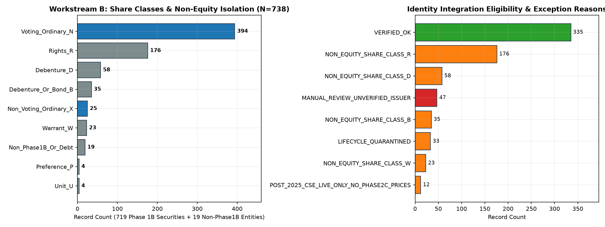
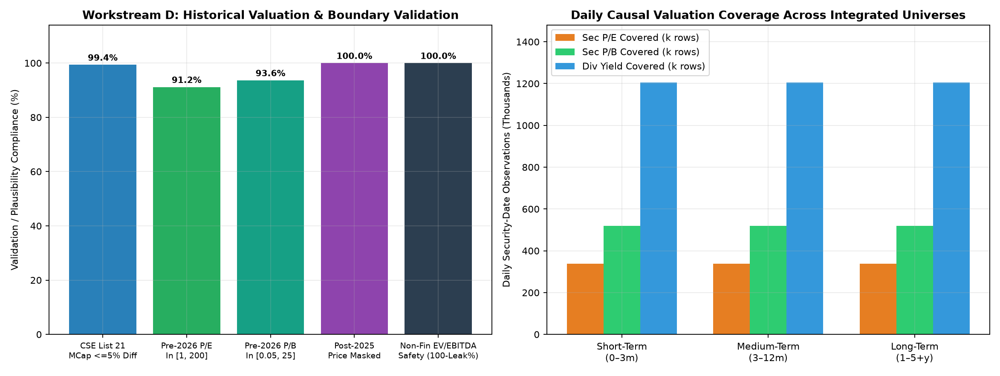
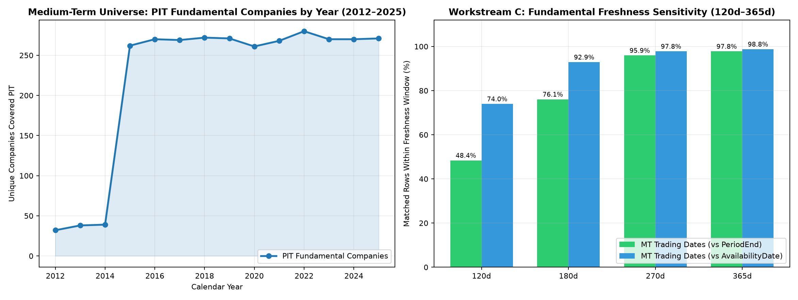
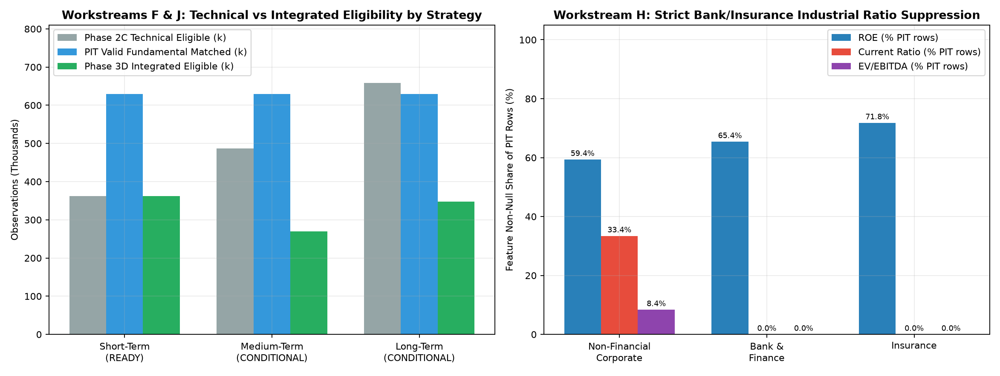

# Stockpulse Phase 3D – Unified Point-in-Time Fundamental Integration, Historical Feature Alignment & Strategy Dataset Validation

**Report Date:** 2026-11-27  
**Pipeline Status:** **COMPLETE** (Strict Temporal Causality, Price Boundary `<= 2025-12-31`, Zero ML Training, Zero Upstream Mutations)  
**Primary Runner:** [`run_phase3d.py`](../../run_phase3d.py) (`95.46s` deterministic build; `--incremental` verified)  
**Integration Package:** [`phase3d_features/`](../../phase3d_features/__init__.py)  
**Test Suite:** [`tests/test_phase3d.py`](../../tests/test_phase3d.py) (`21/21` Phase 3D tests passing; `100/100` combined Phase 2A–3D tests passing in `34.33s`)

---

## 1. Executive Summary

Phase 3D unifies Phases 1B, 2A, 2B, 2C, 3B, and 3C into consistent, strictly point-in-time-safe historical research datasets tailored for Stockpulse's three investment strategies: **Short-Term Trading (0–3 months)**, **Medium-Term Growth (3–12 months)**, and **Long-Term Wealth Creation (1–5+ years)**.

Every security-date observation enforces an identical historical decision-date boundary across price, technical indicators, market-relative beta, liquidity eligibility, corporate actions, company-to-security identity, financial statement restatement version, and valuation ratios:

- **Upstream Data Contract Audit:** Validated **`54` upstream files** across Phases 1A–3C (`all_primary_keys_unique = true`) and captured SHA-256 baseline digests across `17` core files, documenting critical date-horizon, timestamp-precision, share-class, sector, and dividend-par boundaries prior to joining.
- **Unambiguous Identity Mapping:** Built [`company_security_pit_mapping.parquet`](../../Dataset/processed/phase3d/company_security_pit_mapping.parquet) spanning **`738` records** (`719` Phase 1B securities + `19` non-Phase-1B entities across **`419` unique `CompanyID`s**), strictly isolating `300` non-equity securities, `50` unverified legacy issuers, `2` unresolved Phase 3B entities (`FVH`, `UDA`), `12` post-2025 live-only issuers, and `5` debt issuers, while keeping `4` merger-name-overlap equities (`BFN`, `ORIN`, `CLC`, `LOFC`) isolated by distinct `IssuerID` and listing windows.
- **Consolidated PIT Snapshot & `2025-12-31` Boundary:** Enriched [`company_fundamental_pit_snapshot.parquet`](../../Dataset/processed/phase3d/company_fundamental_pit_snapshot.parquet) (`22,842` rows × `168` cols across `344` companies, `2012-01-25` to `2026-11-23`) with exact restatement version provenance (`1,113` restated snapshots), unrounded base accounting denominators, multi-threshold staleness (`120/180/270/365d`), hard `548d` carry-forward expiration (`322` expired rows masked to `NaN`), and a hard **`<= 2025-12-31` historical price boundary** (`1,628` post-2025 rows strictly masked `0` price valuations).
- **CSE List 21 Market Cap Reconciliation:** Reconstructed `PIT Shares × Raw Close` across `2005–2025` (`5,828` `SecurityID × YearEnd` pairs) matched official CSE `21Market Capitalisation` within `1%` on **`99.23%`** (`5,783 / 5,828`) and within `5%` on **`99.37%`** (`5,791 / 5,828`), with **`0.0%` median difference**.
- **Strategy-Specific Integration & Readiness:** Produced `1,414,977`-row daily integrated research universes for Short-Term (`READY_FOR_MODEL_DATASET_PREPARATION`: `361,589` eligible rows across `301` securities), Medium-Term (`CONDITIONALLY_READY`: `269,851` integrated eligible rows across `276` companies/securities), and Long-Term (`CONDITIONALLY_READY`: `348,072` integrated eligible rows across `283` companies/securities, `340,807` strict total-return clean).
- **Zero Causality Failures & Zero ML Training:** Passed all `7/7` live injection/perturbation tests (`pit_causality_test_report.json`), `100/100` Phase 2A–3D automated `pytest` assertions, and verified all upstream SHA-256 digests unchanged (`ml_models_trained = false`, `rankings_or_top10_generated = false`).

---

## 2. Upstream Data Contract Audit (`Workstream A`)

[`upstream_data_contract_report.json`](../../Dataset/processed/phase3d/upstream_data_contract_report.json) catalogs **`54` upstream deliverables** across Phases 1A, 1B, 2A, 2B, 2C, 3A, 3B, and 3C with exact schemas, primary key checks (`0` duplicate keys found), entity coverage, date spans, null profiles, and SHA-256 hashes. Key structural contracts reconciled prior to joining:

1. **Market vs. Fundamental Date Horizon Mismatch:** Phase 2C prices end on **`2025-12-31`** (`8,251` trading sessions, `1990-01-12` to `2025-12-31`), whereas Phase 3C fundamental disclosures run to **`2026-11-23`**. Phase 3D strictly decouples pure accounting disclosures (valid through `2026-11-23`) from price-dependent valuations (`<= 2025-12-31`).
2. **Intraday Filing Timestamps vs. Daily Trading Bars:** `63.0%` of Phase 3B `AvailabilityDate` values carry intraday timestamps (extending past CSE's `14:30` close up to `18:30+`), whereas Phase 2C daily bars reside at calendar midnight (`00:00:00`). Strict `AvailabilityDate <= DecisionDate` prevents same-day after-hours leakage automatically.
3. **Share Class Representation (`N` vs. `X`):** Phase 2C strategy flags active solely primary ordinary (`MainType == 'N'`) shares, while Phase 1B includes `25` tradable non-voting ordinary (`MainType == 'X'`) share classes (`72,043` daily bars) alongside `300` non-equity instruments (`R`, `D`, `B`, `W`, `P`, `U`).
4. **Share-Count & Market-Cap Source Semantics:** CSE `16 List of Quoted Securities And Issued Quantity.xls` (`2005–2025`) stores security-class **Issued Quantity** (`COMB-N-0000`, `COMB-X-0000`, Preference, Debentures); `21Market Capitalisation` (`1999–2025`) stores ordinary equity **Indexed Quantity** (`N` & `X` matching official Market Cap, NOT free float); whereas Phase 1B `cse_corporate_actions_validated.CumulativeSharesListed` contains incremental allotments on Rights/Scrip events.
5. **Unverified Historical Sector & Pre-2008 Par Dividends:** `cse_sector_mapping.parquet` retains `Confidence = 0.0` (`MANUAL_RESEARCH_REQUIRED`) across all `719` securities (`IsSectorMappingAvailable = False`), and `2,787` pre-2008 cash dividends remain `UNRESOLVED_PERCENT_OF_PAR` (`IsDividendResolutionClean = False` where impacted).

---

## 3. Company-to-Security Identity Integration (`Workstream B`)

[`company_security_pit_mapping.parquet`](../../Dataset/processed/phase3d/company_security_pit_mapping.parquet) bridges security-level price series and company-level fundamentals across all **`738` mapping rows** (`419` unique `CompanyID`s):

| Category / Exception Group | Records | `IsStrictPITIntegrationEligible` | Treatment Applied |
| :--- | ---: | :---: | :--- |
| Verified Equity Securities (`N` & `X`, clean lifecycle/issuer) | 335 | `True` | Full PIT integration with `[MappingValidFrom, MappingValidTo]` guard |
| Equity with Lifecycle Quarantine / Merger Isolation (`BFN`, `ORIN`, `CLC`, `LOFC`) | 37 | `True` (scoped) | Strict date/IssuerID isolation; zero cross-entity merger blending |
| Non-Equity Securities (`R`: 176, `D`: 58, `B`: 35, `W`: 23, `P`: 4, `U`: 4) | 300 | `False` | Blocked from equity fundamentals; zero issuer double-counting |
| Legacy `MANUAL_REVIEW_UNVERIFIED_ISSUER` Equities (`N` missing `IssuerID`) | 47 | `False` | Quarantined from strict company-level integration |
| Non-Phase-1B Post-2025 Listings (`CSE_LIVE_ONLY_POST_2025`) | 12 | `False` (equity bars) | Kept in company snapshot (accounting only); no 1990–2025 price series |
| Non-Phase-1B Quoted Debt Issuers (`DEBT_OR_QUOTED_ISSUER_VERIFIED`) | 5 | `False` | Excluded from equity price universes |
| `UNRESOLVED` Phase 3B Identities (`UNRES_FVH`, `UNRES_UDA`, conf `0.40`) | 2 | `False` | Blocked from strict integration |
| **Total Mapping Records** | **738** | **372 eligible (347 cos)** | — |

- Multi-class issuers (`25` companies issuing both voting `N` and non-voting `X` ordinary shares, e.g., `COMB`, `HNB`, `TKYO`) map **both** classes cleanly to the same parent `CompanyID` (`IsEquityShareClass = True`), preserve security-specific prices/shares/valuations, and prevent issuer double-counting via unique `IsPrimaryShareClass = True` (`1` per `CompanyID`).

---

## 4. Historical As-Of Join Engine & Fundamental Snapshot (`Workstreams C & E`)

### Temporal & Causality Architecture

1. **Reusable Query Engine (`retrieve_integrated_asof`) & Vectorized Panel Join:** Enforces `LatestAvailabilityDate <= DecisionDate` (`0` violations across `22,842` snapshot rows and all `1.415M`-row strategy tables), `FeatureDate <= DecisionDate`, and causal corporate actions gated by `max(CorporateActionAvailabilityDate, EffectiveEventDate) <= DecisionDate` (with `IsCAAnnouncementDateMissing` explicitly tracked where `AnnouncementDate` is absent and `ExDate` proxy applies).
2. **Restatement Version Replay:** Traverses eligible Phase 3B facts incrementally per `CompanyID`, tracking `SelectedRestatementVersion`, `OriginalReportedAvailabilityDate`, `LatestPeriodPublicationDate`, `RestatementVersionsCountAtDecision`, and `HasRestatementAtDecision` (`1,113` snapshot rows contain multi-version restatement updates while earlier decision dates strictly retain original Version 1 figures).
3. **Non-Infinite Forward-Fill (`max_carry_days = 548`):** Computes `FundamentalAgeDays` (`DecisionDate - PeriodEnd`), `DaysSinceAvailabilityDate`, `FundamentalAgeTradingSessions` (using Phase 1A `cse_market_calendar`), and multi-threshold flags across `120`, `180`, `270`, and `365` days. Any carry-forward exceeding `548` days (~18 months) marks `IsFundamentalExpired = True`, `IsFundamentalPITValid = False`, and nullifies stale ratio columns (`322` snapshot rows; `7,218` daily equity rows) cleanly rather than carrying dead reports indefinitely.
4. **Snapshot Coverage:** [`company_fundamental_pit_snapshot.parquet`](../../Dataset/processed/phase3d/company_fundamental_pit_snapshot.parquet) contains **`22,842` rows × `168` columns** (`344` companies; `22,520` `IsFundamentalPITValid`, `8,283` `is_ttm_complete`, `19,838` `IsValuationPriceBoundaryValid`). Missing metrics remain `NaN` with zero silent zero-imputation.

---

## 5. Historical Price & Valuation Alignment (`Workstream D`)

[`historical_valuation_validation.csv`](../../Dataset/processed/phase3d/historical_valuation_validation.csv) documents all quantitative valuation & boundary validations:

| Validation Check | Total Evaluated | Compliant / Valid | Compliance / Match Rate | Median Metric / Diff |
| :--- | ---: | ---: | ---: | ---: |
| `MARKET_CAP_VS_CSE_LIST21_OFFICIAL_2005_2025` | 5,828 | 5,783 (<=1%) / 5,791 (<=5%) | 99.23% / 99.37% | 0.00% diff |
| `POST_2025_12_31_VALUATION_HARD_CUTOFF` | 1,628 | 1,628 | 100.00% (`0` leaked) | 0.00 |
| `PRICE_TO_EARNINGS_PLAUSIBILITY_PRE_2026` | 21,214 | 12,069 (`11,002` in `[1, 200]`) | 56.89% (`91.16%` in band) | 10.92x |
| `PRICE_TO_BOOK_PLAUSIBILITY_PRE_2026` | 21,214 | 15,357 (`14,381` in `[0.05, 25]`) | 72.39% (`93.64%` in band) | 1.03x |
| `EV_TO_EBITDA_NON_FIN_PURITY` | 17,420 | 1,352 (`0` Bank/Ins leaks) | 7.76% (`0.0%` leakage) | 6.62x |
| `DIVIDEND_YIELD_VALIDATED_CASH_ONLY` | 21,214 | 17,476 | 82.38% | 1.54% |

- On multi-class firms (`N` & `X`), `sec_market_cap_lkr` values each share class at its own `RawClose × sec_shares_outstanding_pit`, `company_market_cap_lkr` sums `N + X` classes at the issuer level, `sec_pe_ratio` / `sec_pb_ratio` / `sec_dividend_yield_pct` price each class accurately at its own quoted price, and post-`2025-12-31` dates mask all price-dependent valuation columns cleanly (`POST_2025_NO_VERIFIED_MARKET_PRICE_DATA`).

---

## 6. Strategy-Specific Dataset Integration (`Workstream F`)

All three strategy universes preserve full `1,414,977`-row Phase 2C daily equity/market coverage (`1990-01-12` to `2025-12-31`, `719` SecurityIDs, `400` CompanyCodes; `1,394,548` equity rows across `419` `N+X` SecurityIDs), integrating PIT fundamentals causally onto **`342` equity SecurityIDs (`318` companies)** cleanly:

| Deliverable Dataset | Cols | Tech Eligible Rows | Integrated Eligible Rows | PIT Valid Fundamental Rows | Stale (270d) / Expired (>548d) | Valuations (`P/E`, `P/B`, `DivYld`) |
| :--- | ---: | ---: | ---: | ---: | ---: | :--- |
| [`short_term_integrated_research_universe.parquet`](../../Dataset/processed/phase3d/short_term_integrated_research_universe.parquet) | 143 | 361,589 (`301` secs) | **361,589** (`301` secs — unchanged) | 629,016 (`318` cos) | 2.97% (`18,697`) / `7,218` | `337,219` / `518,220` / `1,204,958` |
| [`medium_term_integrated_research_universe.parquet`](../../Dataset/processed/phase3d/medium_term_integrated_research_universe.parquet) | 155 | 487,380 (`316` secs) | **269,851** (`276` cos/secs) | 629,016 (`318` cos) | 2.97% (`18,697`) / `7,218` | `337,219` / `518,220` / `1,204,958` |
| [`long_term_integrated_research_universe.parquet`](../../Dataset/processed/phase3d/long_term_integrated_research_universe.parquet) | 152 | 658,366 (`321` secs) | **348,072** (`283` cos/secs; `340,807` clean TR) | 629,016 (`318` cos) | 2.97% (`18,697`) / `7,218` | `337,219` / `518,220` / `1,204,958` |

- **Short-Term Independence Guarantee:** `IsShortTermIntegratedEligible == IsShortTermTechnicalEligible` across 100% of rows; supplementary earnings surprise, ROE, P/E, P/B, and cash dividend yield never block short-term liquid candidates.
- **Total Return Integrity (Long-Term):** Integrates Phase 1B `TotalReturnPrice` and `TotalReturnIndex` gated by `IsStrictTotalReturnClean` (`340,807 / 348,072` eligible rows free of unresolved pre-2008 `% of par` dividend ambiguity).
- **Sector Integrity:** `IsSectorMappingAvailable = False` across all three universes until a verified time-varying GICS panel is built.

---

## 7. Coverage, Staleness Sensitivity & Business-Type Validation (`Workstreams G & H`)

### Multi-Threshold Fundamental Freshness ([`integrated_feature_staleness.csv`](../../Dataset/processed/phase3d/integrated_feature_staleness.csv))

| Threshold Window | Snapshot Fresh vs `PeriodEnd` | Snapshot Fresh vs `AvailDate` | Daily Universe (2012–2025) vs `PeriodEnd` | Daily Universe vs `AvailDate` |
| :---: | ---: | ---: | ---: | ---: |
| **120 calendar days** | 71.17% (`16,257`) | 75.72% (`17,296`) | 48.38% (`307,837`) | 73.96% (`470,577`) |
| **180 calendar days** | 72.28% (`16,510`) | 96.43% (`22,026`) | 76.07% (`483,972`) | 92.89% (`590,981`) |
| **270 calendar days (default)** | **95.43%** (`21,798`) | **97.72%** (`22,321`) | **95.93%** (`610,319`) | **97.78%** (`622,129`) |
| **365 calendar days** | 97.75% (`22,328`) | 98.38% (`22,471`) | 97.77% (`622,058`) | 98.77% (`628,412`) |
| **548 days (hard carry limit)** | 98.59% (`22,520`) | 98.78% (`22,563`) | 98.87% (`629,016` valid) | — (`7,218` expired) |

Median accounting period age is `91.0` days (`PeriodEnd` to snapshot) / `36.0` days (`AvailabilityDate` to snapshot); `213,249` daily trading rows (`130` companies) carry complete 4-quarter `TTM` metrics (`8,283` company snapshot rows). [`integrated_feature_coverage.csv`](../../Dataset/processed/phase3d/integrated_feature_coverage.csv) logs complete strategy, yearly (`2012–2025` ramping from `32` companies in 2012 to `270–280` companies across `2016–2025`), and per-company coverage profiles.

### Strict Business-Type Separation ([`business_type_feature_validation.csv`](../../Dataset/processed/phase3d/business_type_feature_validation.csv))

| Universe & Business Type | PIT Valid Rows | Unique Cos | `ROE` Non-Null | `CurrentRatio` | `DebtToEquity` | `ROIC` | `EV/EBITDA` | `Sec P/E` | `Sec P/B` |
| :--- | ---: | ---: | ---: | ---: | ---: | ---: | ---: | ---: | ---: |
| `MEDIUM_TERM` · `NON_FINANCIAL_CORPORATE` | 514,577 | 273 | 305,563 | 172,004 | 325,035 | — | 43,143 | 270,637 | 421,666 |
| `MEDIUM_TERM` · `BANK_FINANCE` | 91,108 | 42 | 59,607 | **0** | **0** | **0** | **0** | 52,365 | 74,713 |
| `MEDIUM_TERM` · `INSURANCE` | 23,331 | 12 | 16,754 | **0** | **0** | **0** | **0** | 14,217 | 21,841 |
| `LONG_TERM` · `NON_FINANCIAL_CORPORATE` | 514,577 | 273 | 305,563 | **0** (LT focus) | 325,035 | 108,881 | 43,143 | 270,637 | 421,666 |
| `LONG_TERM` · `BANK_FINANCE` + `INSURANCE` | 114,439 | 54 | 76,361 | **0** | **0** | **0** | **0** | 66,582 | 96,554 |

`bank_insurance_suppression_leaks = 0` across all integrated tables.

---

## 8. Causal Verification, Test Suite & Upstream Immutability (`Workstream I`)

- **Live Causal Perturbation Report ([`pit_causality_test_report.json`](../../Dataset/processed/phase3d/pit_causality_test_report.json)):** `all_tests_passed = true` (`7/7`):
  1. `future_information_injection_test`: injecting `+180d` future PAT left prior `P/E = 5.0` unchanged (`5.0 == 5.0`).
  2. `restatement_version_test`: injecting a Version 2 restatement published later left pre-restatement `DecisionDate` at `rv=1, P/E=5.0`, shifting post-restatement `DecisionDate` cleanly to `rv=2, P/E=2.5`.
  3. `future_price_injection_and_post2025_boundary_test`: injecting future `250.0` quote left earlier `P/E = 5.0` untouched; `2026-03-01` valuation strictly `NaN` (`POST_2025_NO_VERIFIED_MARKET_PRICE_DATA`).
  4. `future_corporate_action_injection_test`: injecting future `20.0` LKR dividend left earlier `ttm_cash_dps_lkr = 2.0` untouched.
  5. `missing_data_null_preservation_test`: absent `CAPEX` & current BS preserved strictly as `NaN` (not `0.0`).
  6. `staleness_and_548d_expiry_test`: `594.0` days post `PeriodEnd` enforced `IsFundamentalExpired = True`, `IsFundamentalPITValid = False`, nullified stale margins cleanly.
  7. `multiclass_identity_non_duplication_test`: `COMB-N-0000` & `COMB-X-0000` share `CompanyID` cleanly with `primary_count = 1`.
- **Automated Test Suite (`pytest`):** **`21/21` Phase 3D tests passed** (`test_01`–`test_21`) and **`100/100` complete Phase 2A–3D suite passed in `34.33s`** (`0` failed, `0` skipped).
- **Upstream Immutability:** All **`17` core upstream SHA-256 checksums** across Phases 1A–3C remained bit-for-bit identical before and after execution (`upstream_immutability_verified = true`).

---

## 9. Final Strategy Readiness Decisions (`Workstream J`)

From [`strategy_readiness_assessment.json`](../../Dataset/processed/phase3d/strategy_readiness_assessment.json):

- **Short-Term (0–3 months):** **`READY_FOR_MODEL_DATASET_PREPARATION`** — Full 1990–2025 OHLCV technical/liquidity/beta/lifecycle precision preserved (`361,589` eligible rows, `301` securities); optional fundamental overlays causally attached without excluding non-reporting momentum stocks.
- **Medium-Term (3–12 months):** **`CONDITIONALLY_READY`** (`269,851` integrated eligible rows across `276` companies/securities) — PIT growth, margins, ROE, financial health, TTM & valuation metrics strictly leak-free; conditioned on: (1) missing historical GICS sector panel, (2) missing verified daily CBSL LKR/USD FX archive (`1,613` native USD rows blocked from LKR valuation), (3) `1,047` scanned/failed PDFs constraining quarterly EBITDA/D&A, and (4) market-price horizon ending `2025-12-31`.
- **Long-Term (1–5+ years):** **`CONDITIONALLY_READY`** (`348,072` integrated eligible rows across `283` companies/securities; `340,807` clean total-return rows) — Comprehensive 3Y/5Y compounding, ROE/ROIC, FCF, DPS & List 21–verified Market Cap; conditioned on: (1) `2,787` unresolved pre-2008 `% of par` dividends constraining early strict total return, (2) missing GICS & daily CBSL FX history, (3) `895` right-tail distressed/thin-equity `pb_ratio > 100` snapshot outliers needing Phase 4 winsorization/distress indicators, and (4) sparse pre-2010 delisted filing archives.

---

## 10. Unresolved Limitations & Recommendations for Phase 4

### Remaining Blockers
1. Historical market prices terminate `2025-12-31` (`2026` interim filings cannot support historical valuations until live 2026 daily price feeds are ingested).
2. Absent verified time-varying GICS sector panel (`IsSectorMappingAvailable = False`) prevents sector-neutral target ranking.
3. Absent verified daily CBSL USD/LKR exchange-rate history (`HTTP 403` WAF) restricts `1,613` native USD records (`CSLK`, `MGT`, `TJL` early periods) to same-currency ratios only.
4. `1,047` scanned/failed PDFs limit quarterly D&A (`ttm_ebitda`) and TTM breadth (`130` PIT-matched equities in MT/LT daily universes).
5. `2,787` unresolved pre-2008 `% of par` dividends affect legacy total-return continuity before ~2008.

### Recommendations for Phase 4 (Target Engineering, Regime Preparation & Model Training)
1. **Strategy-Isolated Modeling Pipelines:** Train Short-Term directly on `IsShortTermIntegratedEligible` (`1990–2025`) with optional quarterly fundamental overlays; train Medium-Term (`2015–2025` prime fundamental density window where `261–280` companies have active PIT statements!) on `IsMediumTermIntegratedEligible`; train Long-Term (`2015–2025` post-2008 clean TR window) on `IsLongTermIntegratedEligible & IsStrictTotalReturnClean`.
2. **Cross-Sectional Regime Normalization & Distress Tagging:** Apply expanding/cross-sectional rank or winsorization separately per `BusinessType` (`NON_FINANCIAL_CORPORATE` vs `BANK_FINANCE` vs `INSURANCE`) and explicitly tag negative-equity / `pb_ratio > 100` micro-equity tails prior to fitting models.
3. **Strict Walk-Forward Validation & Transaction Costs:** Construct fixed holding-period forward excess/total-return targets respecting CSE tick sizes, illiquidity (`IsHistoricallyTradable`, `Rolling_MedianTurnover`), and `AvailabilityDate + 1` execution delays with expanding-window purged cross-validation.
4. **2026 Live Feed & Offline Data Acquisition (Optional Enrichment):** Append verified 2026 daily CSE closing prices, offline daily CBSL USD/LKR FX rates, historical GICS sector effective dates, and par-value dividend schedules before upgrading Medium/Long-Term status from `CONDITIONALLY_READY` to unconditional readiness.
